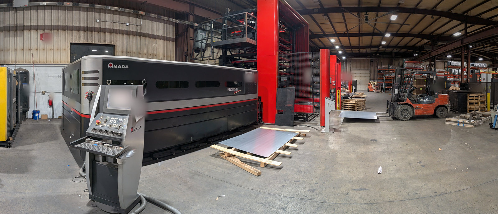
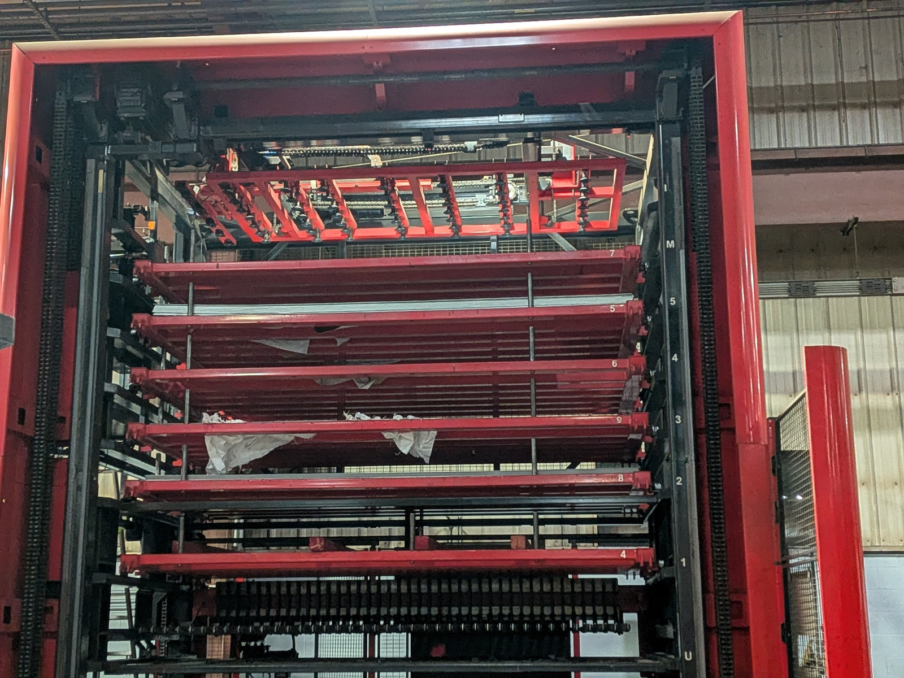

  

<h1 align="center">Jason Vines</h1>

<strong>⚙️ CNC Laser Programmer / Machinist</strong>

  
  
  
  

📍 Fairview, Georgia &nbsp;·&nbsp; ✉️ <a href="mailto:masstat.jv@gmail.com">masstat.jv@gmail.com</a>

## What I Do

At [Metalworking Solutions](https://www.metalworkingsolutions.com/), I do CNC laser programming and I run the lasers, including machines with full automation. I cut stainless steel, aluminum, and HRPO (hot rolled pickled and oiled) steel, usually from 10 gauge to 16 gauge.

- **Machines:** Amada lasers: 3015 and 4020 beds, 4kW, 6kW and 15kW, F1, with full automation
- **Materials:** Stainless steel, aluminum, and HRPO (hot rolled pickled and oiled) steel
- **Thickness:** Usually 10 gauge to 16 gauge

## Equipment I Run

<table>
  <tr>
    <td width="50%" valign="top">
      
       
      <em>Amada 3015 4K laser with automation (photo I took at work)</em>
    </td>
    <td width="50%" valign="top">
      
       
      <em>Amada AS-LUL tower automation (photo I took at work)</em> 
      The tower has 7 material shelves, 3 cutting shelves, and 1 finished-goods shelf. The 3 cutting shelves allow continuous loading and unloading when running large jobs.
    </td>
  </tr>
</table>

The links below go to official Amada pages so you can see the equipment. I have not copied Amada's photos onto this page.

- **3015 and 4020 beds** — These bed sizes are shown on Amada America's [ENSIS series](https://www.amada.com/america/ensis-series) and [VENTIS series](https://www.amada.com/america/ventis-aj) pages. A full list of current systems is on Amada America's [Laser Cutting Systems](https://www.amada.com/america/laser-cutting-systems) page.
- **4kW, 6kW, and 15kW** — 6kW and 15kW are listed on the [ENSIS series](https://www.amada.com/america/ensis-series) page. 6kW is also listed on the [VENTIS series](https://www.amada.com/america/ventis-aj) page. 4kW is listed on Amada's official [F1 series](https://www.amada.co.jp/english/products/bankin/laser/lc_f1_nt_series.html) page.
- **F1** — See Amada's official [F1 series](https://www.amada.co.jp/english/products/bankin/laser/lc_f1_nt_series.html) page (also listed on [Amada Canada](https://www.amada.ca/laser-f1)). There is not a current F1 product page on Amada America's website.
- **Full automation** — See Amada America's [AMS CL/CLT](https://www.amada.com/america/ams-3015-cl) load/unload systems (including 3015 setups) and [blanking automation](https://www.amada.com/america/blanking-automation) pages.

I am not claiming a specific Amada model name beyond what I run: 3015 and 4020 beds, 4kW, 6kW, 15kW, F1, and full automation.

## Summary

CNC Programmer and Machinist with 3+ years of CNC experience. I currently do CNC laser programming at [Metalworking Solutions](https://www.metalworkingsolutions.com/). Previously, I did CAD/CAM programming and machine setup at Victory Sign Industries, cutting production time by 20% through efficient setups and improving part accuracy by 15%.

I also have experience in manual machining, quality control, training new operators, and leading production teams. I am seeking a CNC Programmer role.

## Core Skills

- **CNC Programming:** CNC laser programming at [Metalworking Solutions](https://www.metalworkingsolutions.com/) (current); CAD/CAM programming at Victory Sign Industries
- **Lasers & Equipment:** Amada lasers: 3015 and 4020 beds, 4kW, 6kW and 15kW, F1, with full automation
- **Materials:** Stainless steel, aluminum, and HRPO steel, usually 10 gauge to 16 gauge
- **Setup & Machining:** CNC machine setup, CNC operation, CNC laser operation, manual machining
- **Quality & Process:** Quality control, workflow and process improvement, equipment maintenance
- **Leadership:** Training new operators, production supervision (20+ people), inventory control

## Work Experience

### CNC Laser Programmer / Machinist
**[Metalworking Solutions (MWS)](https://www.metalworkingsolutions.com/)** — Chattanooga, TN  
*June 2026 – Present*

- Program the CNC lasers for the shop
- Run Amada lasers (3015 and 4020 beds, 4kW, 6kW and 15kW, F1, with full automation) on 2nd shift in a precision metal fabrication shop
- Program and cut stainless steel, aluminum, and HRPO steel, usually 10 gauge to 16 gauge
- Apply setup, quality-control, and machine-maintenance experience to keep jobs accurate and on schedule

### Manual Machinist
**LaBrie Group**  
*November 2025 – June 2026*

- Performed precision manual machining for heavy-duty components

### CNC Laser Machine Operator
**Alloway Stamping & Machine / Wise Staffing**  
*June 2025 – November 2025*

- Operated CNC machines to achieve precision manufacturing results
- Machined outsourced parts for major clients
- Maintained equipment to ensure minimal downtime and consistent output

### CNC Operator / Machinist
**Victory Sign Industries** — Fort Oglethorpe, GA  
*February 2023 – October 2025*

- Programmed CNC jobs using CAD/CAM software, turning designs into accurate machine programs
- Set up CNC machines for production runs; reduced production time by 20% through efficient setups
- Implemented quality control measures, improving product accuracy by 15%
- Operated and maintained CNC machines for precise, consistent output with minimal downtime
- Trained new operators, boosting team productivity and skill levels
- Streamlined workflow and consistently met or exceeded production targets

### Production Supervisor
**Old Mill Kettle Corn** — Chickamauga, GA  
*March 2020 – January 2023*

- Led a team of 20+ employees to achieve 95% production efficiency
- Trained staff, reducing errors by 40%; collaborated with engineering to improve product quality by 20%
- Managed inventory, cutting costs by 15% annually; achieved a 98% on-time delivery rate

### Picker
**Amazon** — Chattanooga, TN  
*July 2015 – March 2020*

- Achieved 99% picking accuracy and exceeded daily targets by 20% using scanning technology for real-time inventory tracking

### Restoration Technician
**ServPro** — LaFayette, GA  
*May 2011 – July 2015*

- Restored properties after water, fire, and mold damage while maintaining high safety standards

## Tools and Software

- Amada lasers: 3015 and 4020 beds, 4kW, 6kW and 15kW, F1, with full automation
- CNC laser programming (at [Metalworking Solutions](https://www.metalworkingsolutions.com/))
- CAD/CAM software (used at Victory Sign Industries to turn designs into accurate machine programs)
- CNC machine setup, CNC operation, and CNC laser operation
- Manual machining
- Quality control, workflow and process improvement, and equipment maintenance

## Education

**GED** — Hixson High School, Chattanooga, TN (1991 – 1995)

## Project Showcase

See the [projects](./projects/) folder for a simple template I can use to add photos and notes about parts I have programmed and cut.

## Resources

- [Laser Cutting Quick Reference](./tips/README.md) — a gauge-to-thickness chart and general programming and nesting tips
- [Resume (PDF)](./resume/Jason_Vines_Resume.pdf)

## Contact

- **Email:** [masstat.jv@gmail.com](mailto:masstat.jv@gmail.com)
- **Location:** Fairview, Georgia
