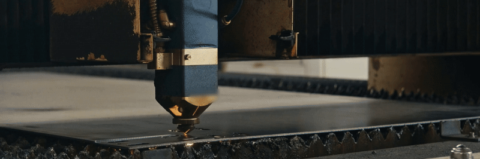
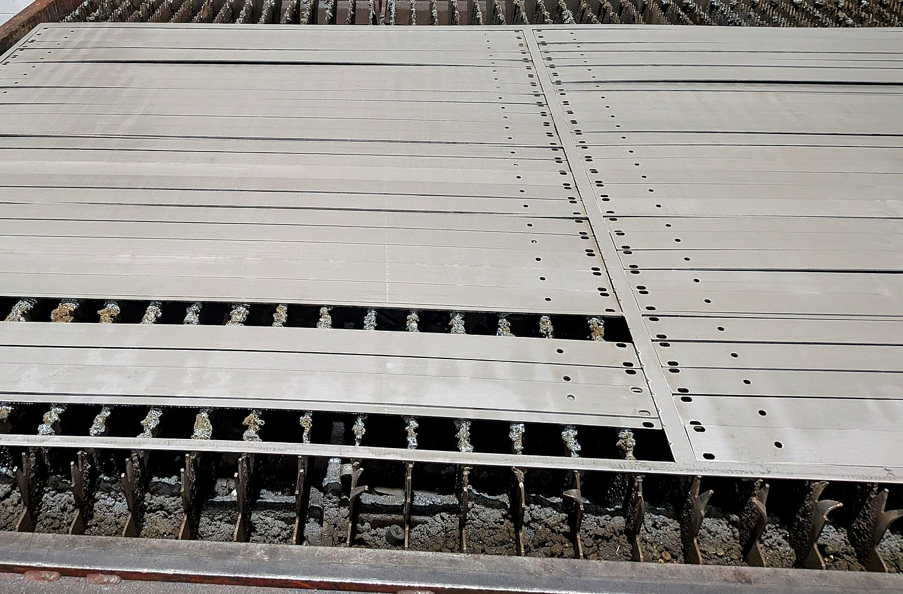

  
   
  Stock video: <a href="https://www.pexels.com/video/precision-laser-cutting-in-industrial-workshop-30455960/">Cemrecan Yurtman / Pexels</a>

  <picture>
    <source media="(prefers-color-scheme: dark)" srcset="assets/banner-steel-dark-animated.svg">
    <source media="(prefers-color-scheme: light)" srcset="assets/banner-steel-light-animated.svg">
    
  </picture>

<strong>⚙️ CNC Laser Programmer / Machinist</strong>

  

  
  
  
  

📍 Fairview, Georgia &nbsp;·&nbsp; ✉️ <a href="mailto:masstat.jv@gmail.com">masstat.jv@gmail.com</a>

  <a href="#what-i-do">What I Do</a> &nbsp;·&nbsp;
  <a href="#equipment-i-run">Equipment</a> &nbsp;·&nbsp;
  <a href="#core-skills">Skills</a> &nbsp;·&nbsp;
  <a href="#work-experience">Experience</a> &nbsp;·&nbsp;
  <a href="./projects/">Projects</a> &nbsp;·&nbsp;
  <a href="./tips/README.md">Quick Reference</a> &nbsp;·&nbsp;
  <a href="./resources/HELPFUL_LINKS.md">Helpful Links</a> &nbsp;·&nbsp;
  <a href="#contact">Contact</a>

  

## 🔧 What I Do

At [Metalworking Solutions](https://www.metalworkingsolutions.com/), I do CNC laser programming and I run the lasers, including machines with full automation. I cut stainless steel, aluminum, and HRPO (hot rolled pickled and oiled) steel, usually from 10 gauge to 16 gauge.

CNC Programmer and Machinist with 3+ years of CNC experience. I am seeking a CNC Programmer role.

| | |
| :--- | :--- |
| **Machines** | Amada lasers: 3015 and 4020 beds, 4kW, 6kW and 15kW, F1, with full automation |
| **Materials** | Stainless steel, aluminum, and HRPO (hot rolled pickled and oiled) steel |
| **Thickness** | Usually 10 gauge to 16 gauge |
| **Programming** | CNC laser programming at [Metalworking Solutions](https://www.metalworkingsolutions.com/) (current); CAD/CAM programming at Victory Sign Industries |
| **CAD/CAM** | CAD/CAM software (used at Victory Sign Industries to turn designs into accurate machine programs) |
| **Setup & machining** | CNC machine setup, CNC operation, CNC laser operation, manual machining |
| **Quality & process** | Quality control, workflow and process improvement, equipment maintenance |
| **Leadership** | Training new operators, production supervision (20+ people), inventory control |

Previously, I did CAD/CAM programming and machine setup at Victory Sign Industries, cutting production time by 20% through efficient setups and improving part accuracy by 15%. I also have experience in manual machining, quality control, training new operators, and leading production teams.

  

## 🏭 Equipment I Run

<table>
  <tr>
    <td width="50%" valign="top">
      
       
      <em>Amada 3015 4K laser with automation (photo I took at work)</em>
    </td>
    <td width="50%" valign="top">
      
       
      <em>Amada AS-LUL tower automation (photo I took at work)</em> 
      The tower has 7 material shelves, 3 cutting shelves, and 1 finished-goods shelf. The 3 cutting shelves allow continuous loading and unloading when running large jobs.
    </td>
  </tr>
</table>

The links below go to official Amada pages so you can see the equipment. I have not copied Amada's photos onto this page.

| What I run | Official Amada pages |
| :--- | :--- |
| **3015 and 4020 beds** | [ENSIS series](https://www.amada.com/america/ensis-series) · [VENTIS series](https://www.amada.com/america/ventis-aj) · [Laser Cutting Systems](https://www.amada.com/america/laser-cutting-systems) |
| **4kW, 6kW, and 15kW** | [ENSIS series](https://www.amada.com/america/ensis-series) (6kW and 15kW) · [VENTIS series](https://www.amada.com/america/ventis-aj) (6kW) · [F1 series](https://www.amada.co.jp/english/products/bankin/laser/lc_f1_nt_series.html) (4kW) |
| **F1** | [F1 series](https://www.amada.co.jp/english/products/bankin/laser/lc_f1_nt_series.html) · [Amada Canada](https://www.amada.ca/laser-f1). There is not a current F1 product page on Amada America's website. |
| **Full automation** | [AMS CL/CLT](https://www.amada.com/america/ams-3015-cl) · [blanking automation](https://www.amada.com/america/blanking-automation) |

I am not claiming a specific Amada model name beyond what I run: 3015 and 4020 beds, 4kW, 6kW, 15kW, F1, and full automation.

<a href="#top">↑ Back to top</a>

  

## 💼 Work Experience

### ⚡ CNC Laser Programmer / Machinist
**[Metalworking Solutions (MWS)](https://www.metalworkingsolutions.com/)** — Chattanooga, TN  
*June 2026 – Present*

- Program the CNC lasers for the shop
- Run Amada lasers (3015 and 4020 beds, 4kW, 6kW and 15kW, F1, with full automation) on 2nd shift in a precision metal fabrication shop
- Program and cut stainless steel, aluminum, and HRPO steel, usually 10 gauge to 16 gauge
- Apply setup, quality-control, and machine-maintenance experience to keep jobs accurate and on schedule

### 🔩 Manual Machinist
**LaBrie Group**  
*November 2025 – June 2026*

- Performed precision manual machining for heavy-duty components

### 🏭 CNC Laser Machine Operator
**Alloway Stamping & Machine / Wise Staffing**  
*June 2025 – November 2025*

- Operated CNC machines to achieve precision manufacturing results
- Machined outsourced parts for major clients
- Maintained equipment to ensure minimal downtime and consistent output

### ⚙️ CNC Operator / Machinist
**Victory Sign Industries** — Fort Oglethorpe, GA  
*February 2023 – October 2025*

- Programmed CNC jobs using CAD/CAM software, turning designs into accurate machine programs
- Set up CNC machines for production runs; reduced production time by 20% through efficient setups
- Implemented quality control measures, improving product accuracy by 15%
- Operated and maintained CNC machines for precise, consistent output with minimal downtime
- Trained new operators, boosting team productivity and skill levels
- Streamlined workflow and consistently met or exceeded production targets

Earlier work (2011 – 2023)

### 👥 Production Supervisor
**Old Mill Kettle Corn** — Chickamauga, GA  
*March 2020 – January 2023*

- Led a team of 20+ employees to achieve 95% production efficiency
- Trained staff, reducing errors by 40%; collaborated with engineering to improve product quality by 20%
- Managed inventory, cutting costs by 15% annually; achieved a 98% on-time delivery rate

### 📦 Picker
**Amazon** — Chattanooga, TN  
*July 2015 – March 2020*

- Achieved 99% picking accuracy and exceeded daily targets by 20% using scanning technology for real-time inventory tracking

### 🏠 Restoration Technician
**ServPro** — LaFayette, GA  
*May 2011 – July 2015*

- Restored properties after water, fire, and mold damage while maintaining high safety standards

<a href="#top">↑ Back to top</a>

  

## 🎓 Education

**GED** — Hixson High School, Chattanooga, TN (1991 – 1995)

  

## 📸 Project Showcase

Photos of parts I have programmed and cut. Material and thickness are listed when I know them.

<table>
  <tr>
    <td width="50%" valign="top">
      
       <em>Formed channels — 14 ga HRPO</em>
      

        
Notes

        
Formed channels with laser-cut holes, slots, and notches.

        
<strong>Material:</strong> 14 ga HRPO (hot rolled pickled and oiled steel)

      

    </td>
    <td width="50%" valign="top">
      
       <em>Formed channels with slots and cutouts — 14 ga HRPO</em>
      

        
Notes

        
Formed channels with laser-cut slots and cutouts.

        
<strong>Material:</strong> 14 ga HRPO (hot rolled pickled and oiled steel)

      

    </td>
  </tr>
  <tr>
    <td width="50%" valign="top">
      
       <em>Large curved panels — 14 ga HRPO</em>
      

        
Notes

        
Large curved panels.

        
<strong>Material:</strong> 14 ga HRPO (hot rolled pickled and oiled steel)

      

    </td>
    <td width="50%" valign="top">
      
       <em>Laser-cut bottle opener — 11 ga stainless steel</em>
      

        
Notes

        
Laser-cut bottle opener with an animal cutout.

        
<strong>Material:</strong> 11 ga stainless steel

      

    </td>
  </tr>
  <tr>
    <td width="50%" valign="top">
      
       <em>12 gauge HRPO (hot-rolled, pickled and oiled) skeleton after a nested run on the laser.</em>
    </td>
    <td width="50%" valign="top">
      
       <em>Amada 4020 LASMAC cutting head at work.</em>
    </td>
  </tr>
  <tr>
    <td width="50%" valign="top">
      
       <em>Operator console on the Amada 4020 laser.</em>
    </td>
    <td width="50%" valign="top">
      
       <em>Output side of the Amada 4020 laser, with a fresh sheet on the shuttle table.</em>
    </td>
  </tr>
  <tr>
    <td width="50%" valign="top">
      
       <em>Amada 3015 6K laser cutting.</em>
    </td>
    <td width="50%" valign="top">
      
       <em>Slider door latch cut from 12 gauge steel on the Amada 4020 laser.</em>
    </td>
  </tr>
</table>

More notes about each part are in the [projects](./projects/) folder.

<a href="#top">↑ Back to top</a>

  

## 📚 Resources

- [📐 Laser Cutting Quick Reference](./tips/README.md) — a gauge-to-thickness chart and general programming and nesting tips
- [🔗 Helpful Links](./resources/HELPFUL_LINKS.md) — free laser cutting, nesting, and safety resources from other sources, with credit to each one
- [📄 Resume (PDF)](./resume/Jason_Vines_Resume.pdf)

  

## 📬 Contact

- **Email:** [masstat.jv@gmail.com](mailto:masstat.jv@gmail.com)
- **Location:** Fairview, Georgia

<a href="#top">↑ Back to top</a>

  

