

  

  <a href="../">🏠 Home</a> &nbsp;·&nbsp;
  <a href="../projects/">Projects</a> &nbsp;·&nbsp;
  <a href="../gallery/">Gallery</a> &nbsp;·&nbsp;
  <a href="../machines/">Machines</a> &nbsp;·&nbsp;
  <a href="../resume/">Resume</a> &nbsp;·&nbsp;
  <a href="../how-it-works/">How It Works</a>

<h1 align="center">📸 Photo Gallery</h1>

<strong>These are photos of parts I have programmed and cut, and of the Amada lasers I run at work. Material and thickness are listed when I know them.</strong>

  
  

<em>Click any photo to zoom in. Use the arrows to flip through them.</em>

<figure class="stock-photo stock-banner">
  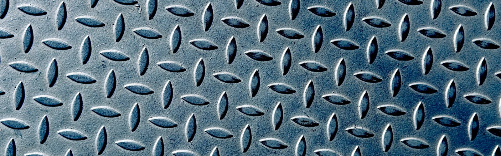
  Stock photo
  <figcaption class="stock-credit">Stock photo: diamond-plate metal texture. <a href="https://www.pexels.com/photo/metal-diamond-plate-texture-background-31413499/">Photo by David Underland on Pexels</a></figcaption>
</figure>

  

## 🔩 Parts

<figure class="photo-tile">
  <a href="../projects/images/part-01.jpg" title="Open the full-size photo">
    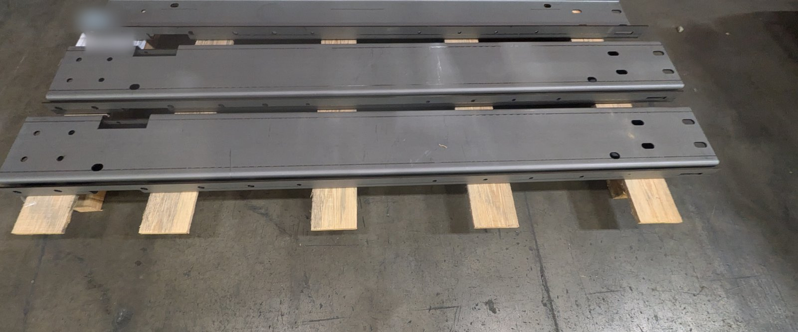
  </a>
  <figcaption class="photo-caption"><em>Formed channels — 14 ga HRPO</em></figcaption>
</figure>

<figure class="photo-tile">
  <a href="../projects/images/part-02.jpg" title="Open the full-size photo">
    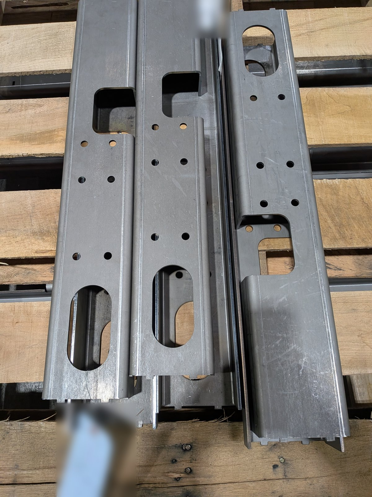
  </a>
  <figcaption class="photo-caption"><em>Formed channels with slots and cutouts — 14 ga HRPO</em></figcaption>
</figure>

<figure class="photo-tile">
  <a href="../projects/images/part-03.jpg" title="Open the full-size photo">
    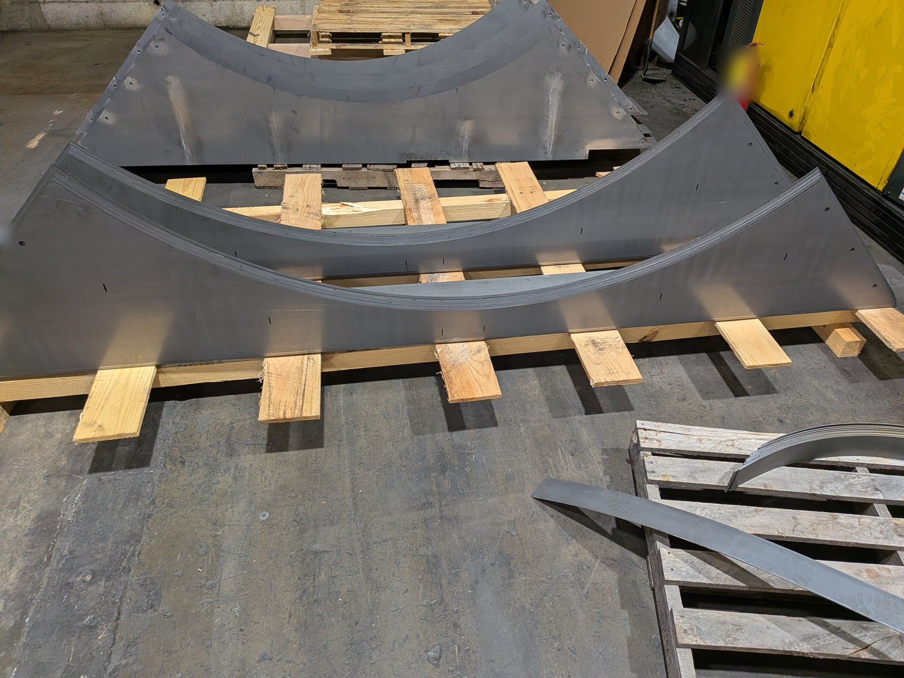
  </a>
  <figcaption class="photo-caption"><em>Large curved panels — 14 ga HRPO</em></figcaption>
</figure>

<figure class="photo-tile">
  <a href="../projects/images/part-04.jpg" title="Open the full-size photo">
    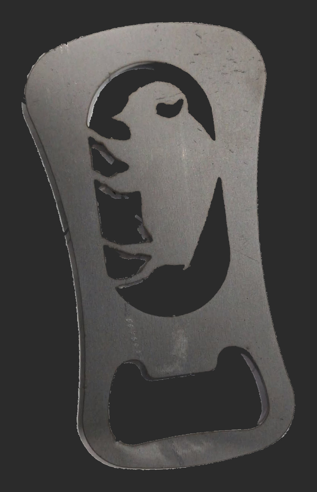
  </a>
  <figcaption class="photo-caption"><em>Laser-cut bottle opener — 11 ga stainless steel</em></figcaption>
</figure>

<figure class="photo-tile">
  <a href="../projects/images/skeleton-12ga-hrpo.jpg" title="Open the full-size photo">
    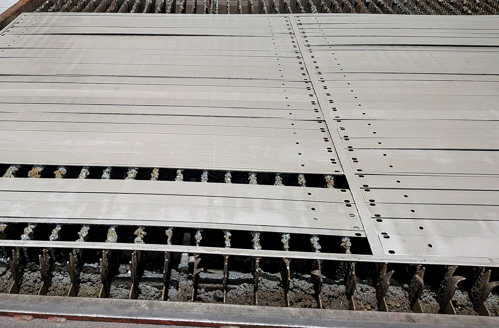
  </a>
  <figcaption class="photo-caption"><em>12 gauge HRPO (hot-rolled, pickled and oiled) skeleton after a nested run on the laser.</em></figcaption>
</figure>

<figure class="photo-tile">
  <a href="../projects/images/slider-door-latch-12ga.jpg" title="Open the full-size photo">
    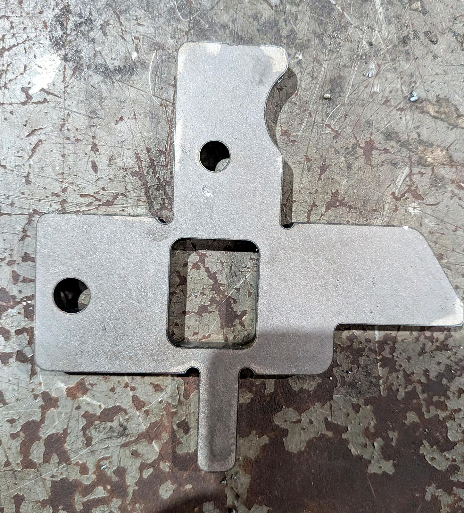
  </a>
  <figcaption class="photo-caption"><em>Slider door latch cut from 12 gauge steel on the Amada FO 4020NT.</em></figcaption>
</figure>

<figure class="photo-tile">
  <a href="../projects/images/galvanized-strips-16ga.jpg" title="Open the full-size photo">
    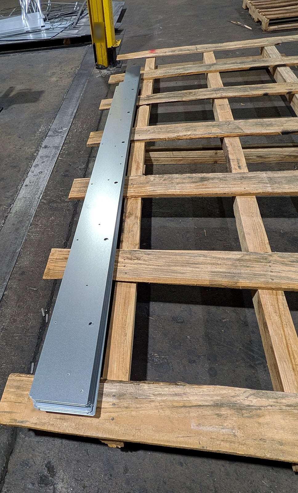
  </a>
  <figcaption class="photo-caption"><em>16 gauge galvanized strips cut on the laser.</em></figcaption>
</figure>

<figure class="photo-tile">
  <a href="../projects/images/galvanized-plate-14ga.jpg" title="Open the full-size photo">
    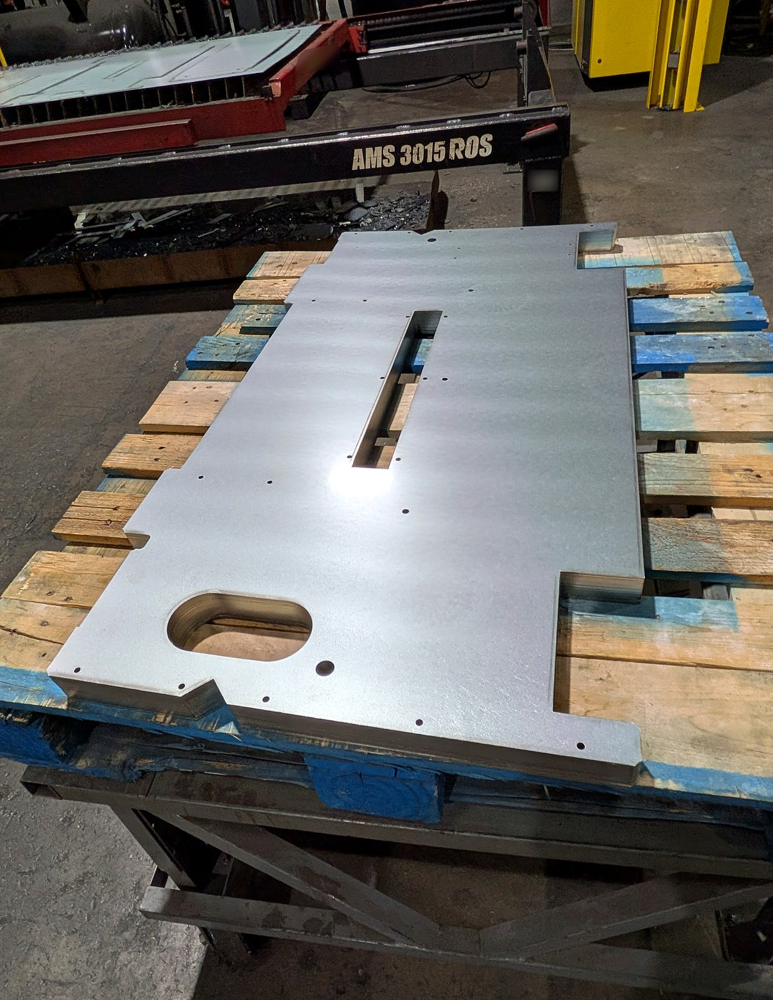
  </a>
  <figcaption class="photo-caption"><em>14 gauge galvanized plate cut on the laser, with the Amada AMS 3015 ROS table in the background.</em></figcaption>
</figure>

<figure class="photo-tile">
  <a href="../projects/images/nest-printout.jpg" title="Open the full-size photo">
    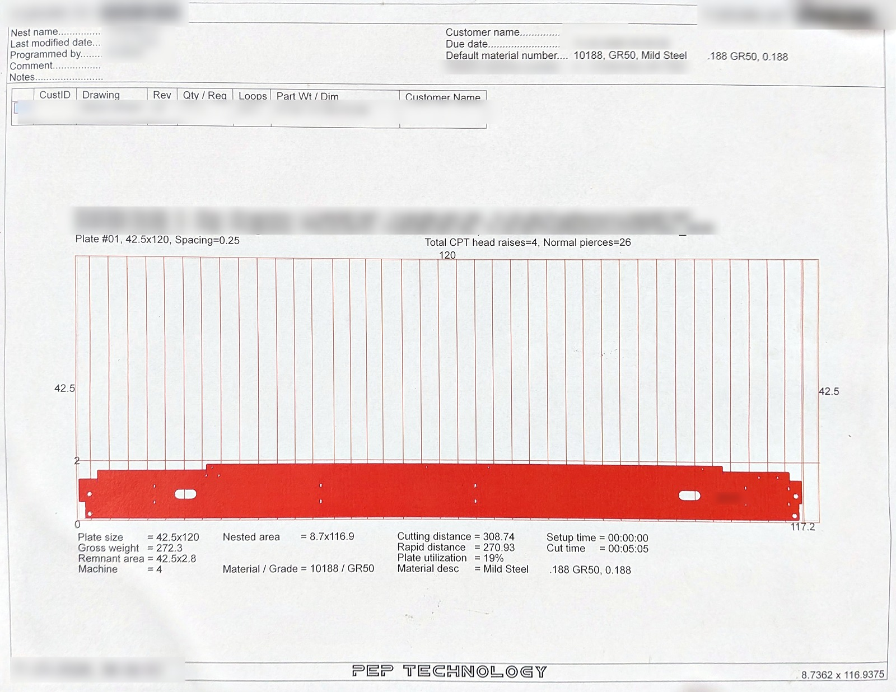
  </a>
  <figcaption class="photo-caption"><em>A nest printout: parts laid out on a 42.5 x 120 inch sheet to save metal.</em></figcaption>
</figure>

<figure class="photo-tile">
  <a href="../projects/images/nest-control-screen.jpg" title="Open the full-size photo">
    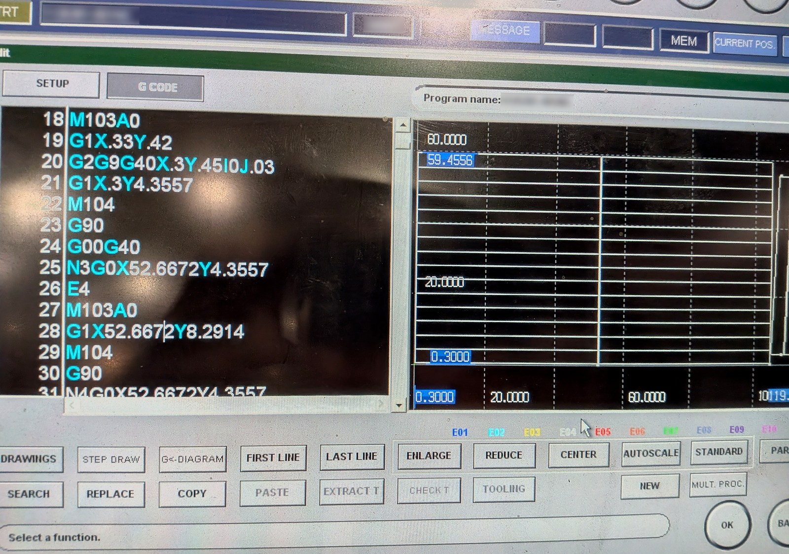
  </a>
  <figcaption class="photo-caption"><em>The cutting program and nest layout on the laser&#x27;s control screen.</em></figcaption>
</figure>

  

## 🏭 Machines

<figure class="photo-tile">
  <a href="../assets/machine-3015-4k.jpg" title="Open the full-size photo">
    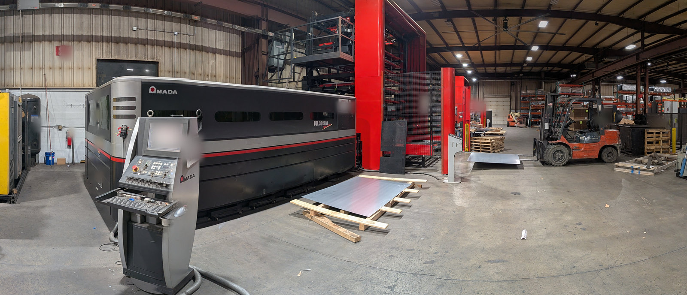
  </a>
  <figcaption class="photo-caption"><em>Amada FOL 3015 AJ 4kW laser with automation (photo I took at work)</em></figcaption>
</figure>

<figure class="photo-tile">
  <a href="../projects/images/fol-3015-aj-4kw.jpg" title="Open the full-size photo">
    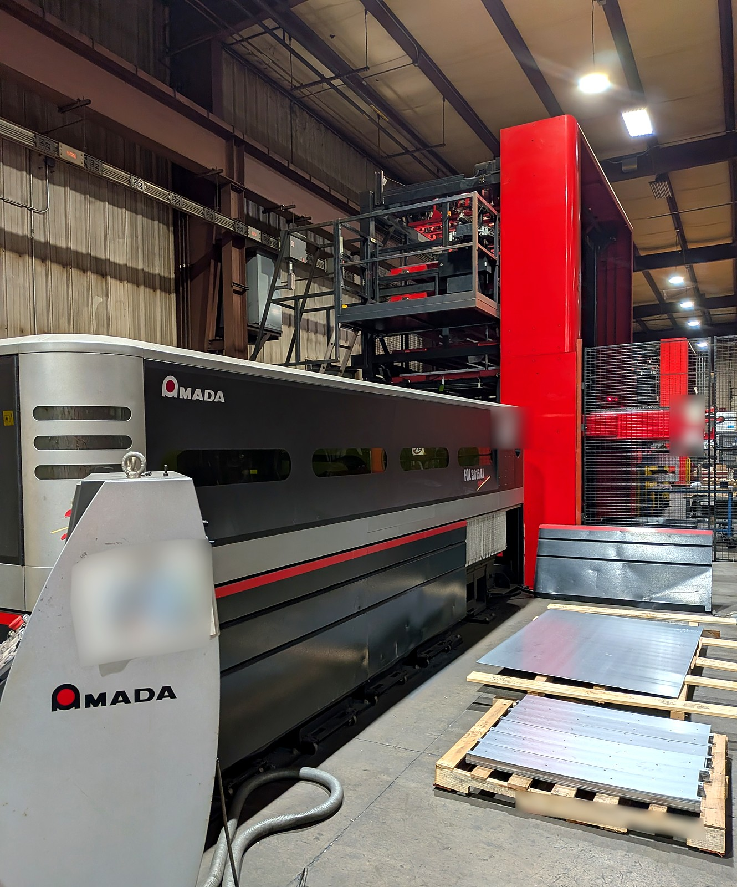
  </a>
  <figcaption class="photo-caption"><em>Amada FOL 3015 AJ 4kW laser cutter with its automation tower.</em></figcaption>
</figure>

<figure class="photo-tile">
  <a href="../assets/tower-as-lul.jpg" title="Open the full-size photo">
    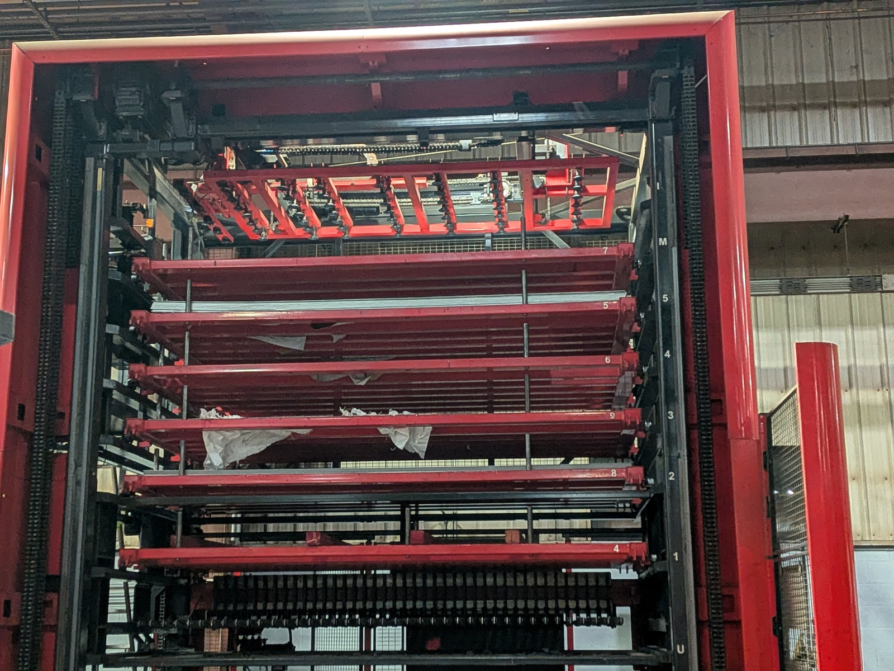
  </a>
  <figcaption class="photo-caption"><em>Amada AS LUL 3015 tower automation (photo I took at work)</em></figcaption>
</figure>

<figure class="photo-tile">
  <a href="../projects/images/amada-fo-4020nt-full-machine.jpg" title="Open the full-size photo">
    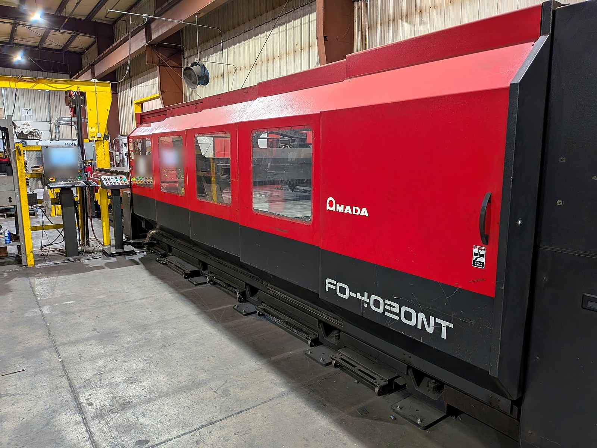
  </a>
  <figcaption class="photo-caption"><em>Amada FO 4020NT laser cutter in the shop.</em></figcaption>
</figure>

<figure class="photo-tile">
  <a href="../projects/images/amada-lcg-3015aj-6kw-full-machine.jpg" title="Open the full-size photo">
    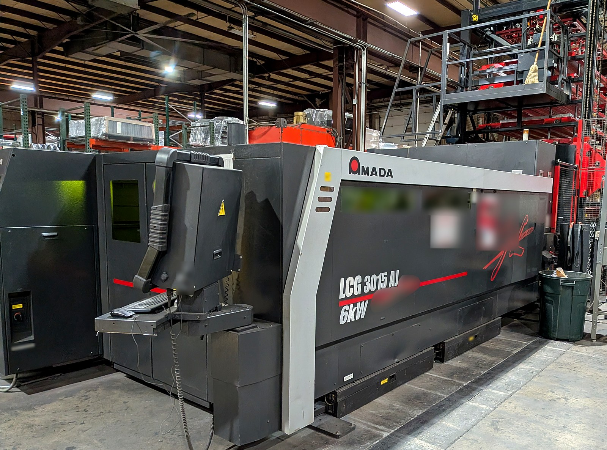
  </a>
  <figcaption class="photo-caption"><em>Amada LCG 3015 AJ 6kW laser cutter.</em></figcaption>
</figure>

<figure class="photo-tile">
  <a href="../projects/images/lcg-3015-aj-console.jpg" title="Open the full-size photo">
    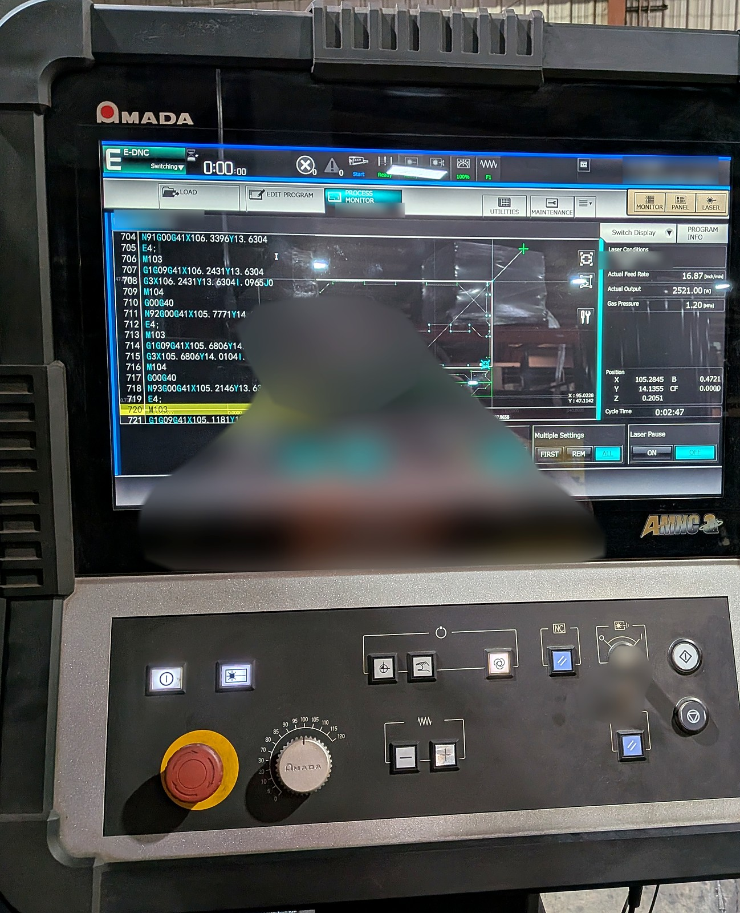
  </a>
  <figcaption class="photo-caption"><em>AMNC 3i control on the Amada 3015 6kW laser.</em></figcaption>
</figure>

<figure class="photo-tile">
  <a href="../projects/images/x-direction-conveyor.jpg" title="Open the full-size photo">
    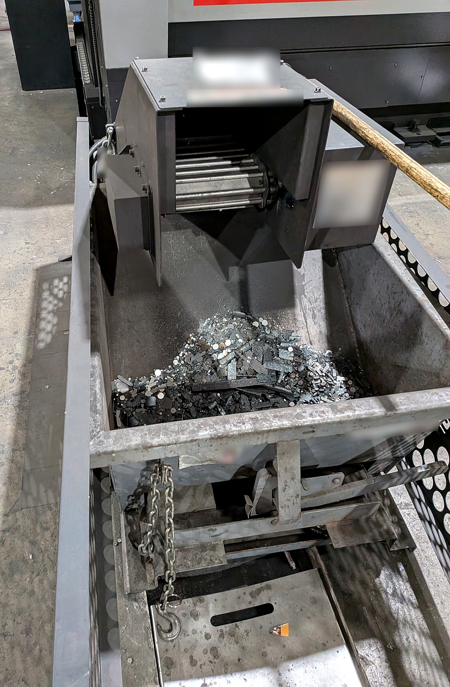
  </a>
  <figcaption class="photo-caption"><em>Amada X-direction conveyor, which carries scrap and small parts out of the machine.</em></figcaption>
</figure>

<figure class="photo-tile">
  <a href="../projects/images/camfil-dust-collector-lcg-3015-aj.jpg" title="Open the full-size photo">
    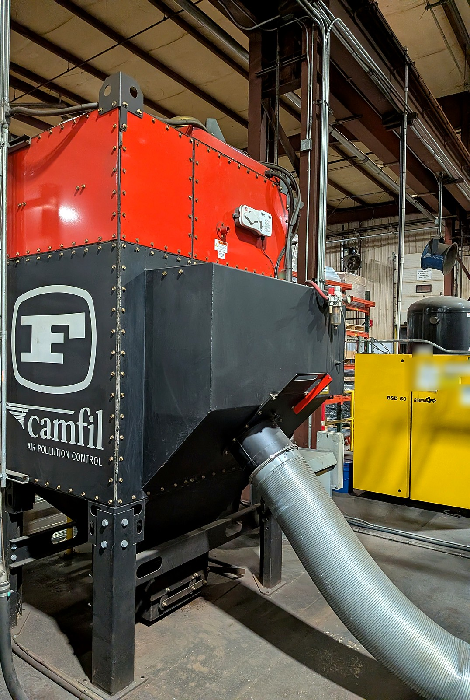
  </a>
  <figcaption class="photo-caption"><em>Camfil dust collector that pulls smoke and dust out of the Amada LCG 3015 AJ 6kW laser.</em></figcaption>
</figure>

<figure class="photo-tile">
  <a href="../projects/images/ensis-3015-aj.jpg" title="Open the full-size photo">
    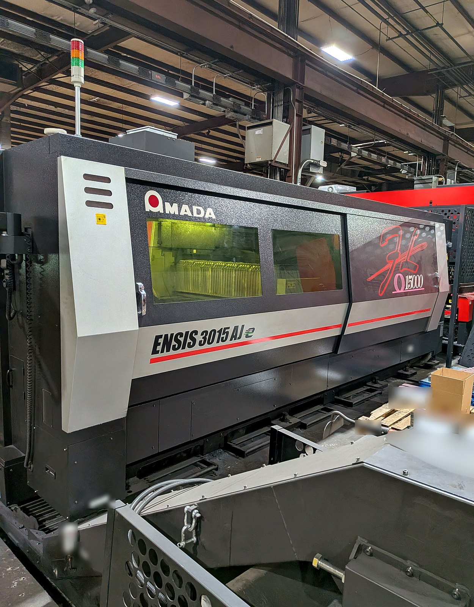
  </a>
  <figcaption class="photo-caption"><em>Amada ENSIS 3015 AJ laser cutting machine, with an FL 15000 badge.</em></figcaption>
</figure>

<figure class="photo-tile">
  <a href="../projects/images/lc-3015-f1-nt.jpg" title="Open the full-size photo">
    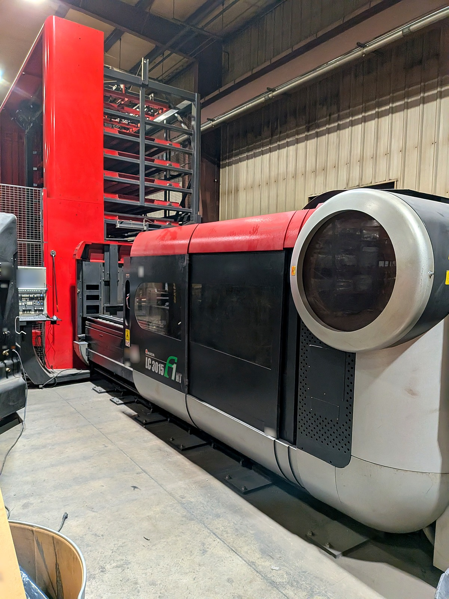
  </a>
  <figcaption class="photo-caption"><em>Amada LC 3015 F1 NT laser cutter with its load/unload tower.</em></figcaption>
</figure>

<figure class="photo-tile">
  <a href="../projects/images/amada-as-lul-3015-table-clearing.jpg" title="Open the full-size photo">
    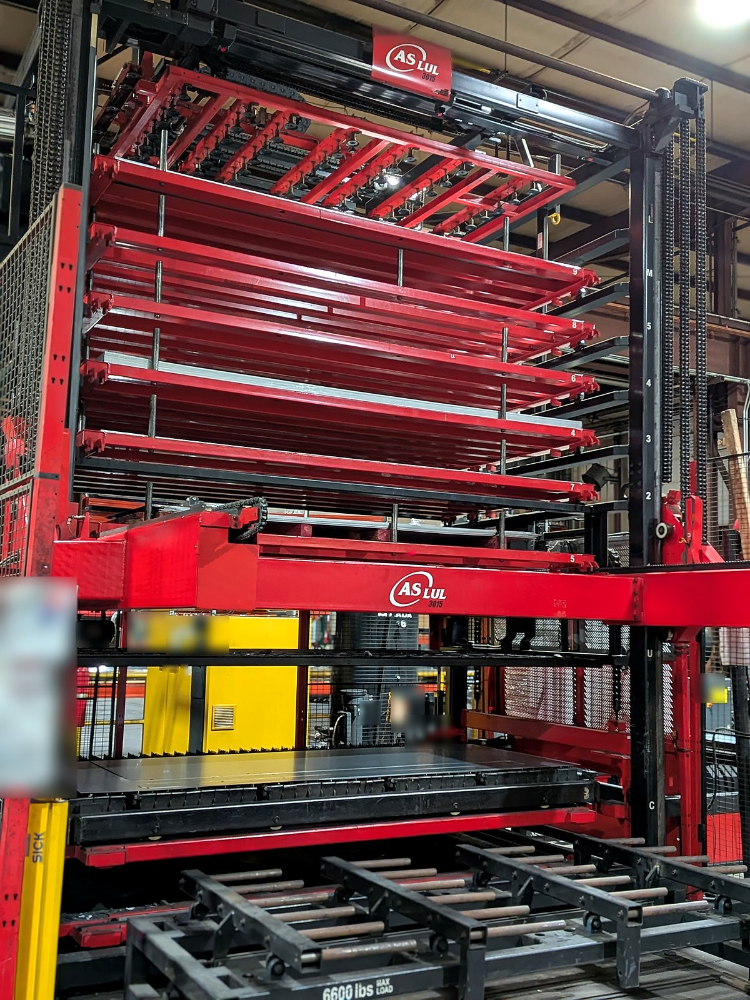
  </a>
  <figcaption class="photo-caption"><em>Amada AS LUL 3015 load/unload tower waiting for table clearing.</em></figcaption>
</figure>

<figure class="photo-tile">
  <a href="../projects/images/as-lul-3015-controller.jpg" title="Open the full-size photo">
    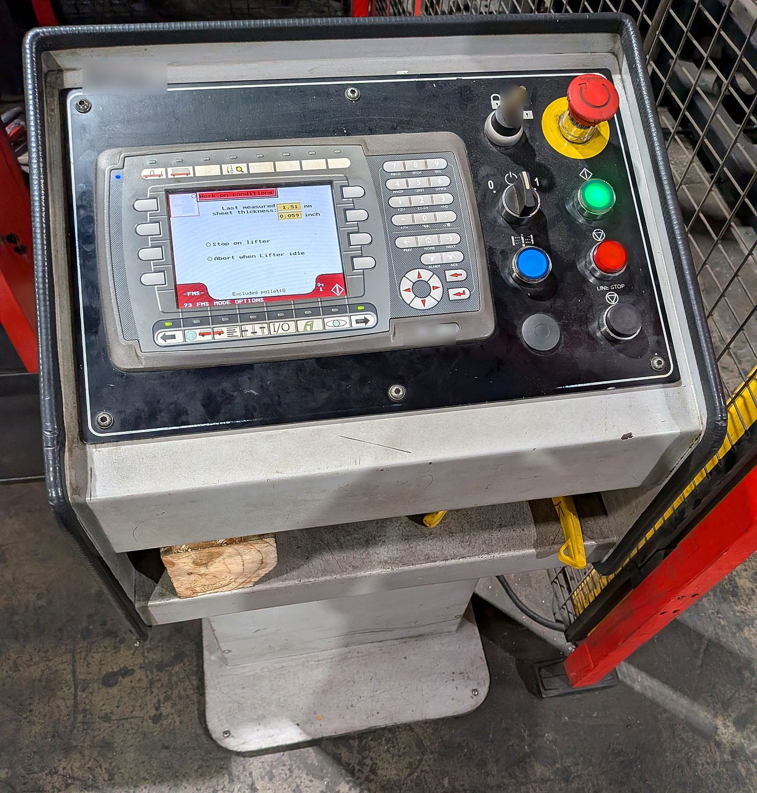
  </a>
  <figcaption class="photo-caption"><em>Operator control panel on the Amada AS LUL 3015 load/unload tower.</em></figcaption>
</figure>

<figure class="photo-tile">
  <a href="../projects/images/as-lul-3015-console.jpg" title="Open the full-size photo">
    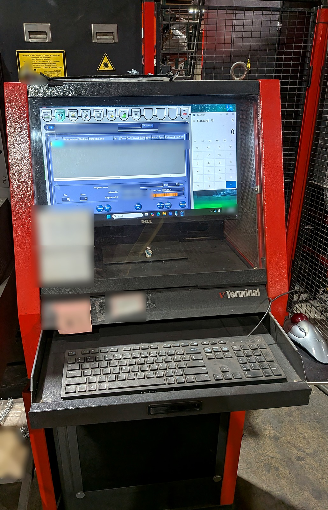
  </a>
  <figcaption class="photo-caption"><em>Control terminal for the Amada AS LUL 3015 load/unload tower.</em></figcaption>
</figure>

<figure class="photo-tile">
  <a href="../projects/images/amada-4020-laser-head.jpg" title="Open the full-size photo">
    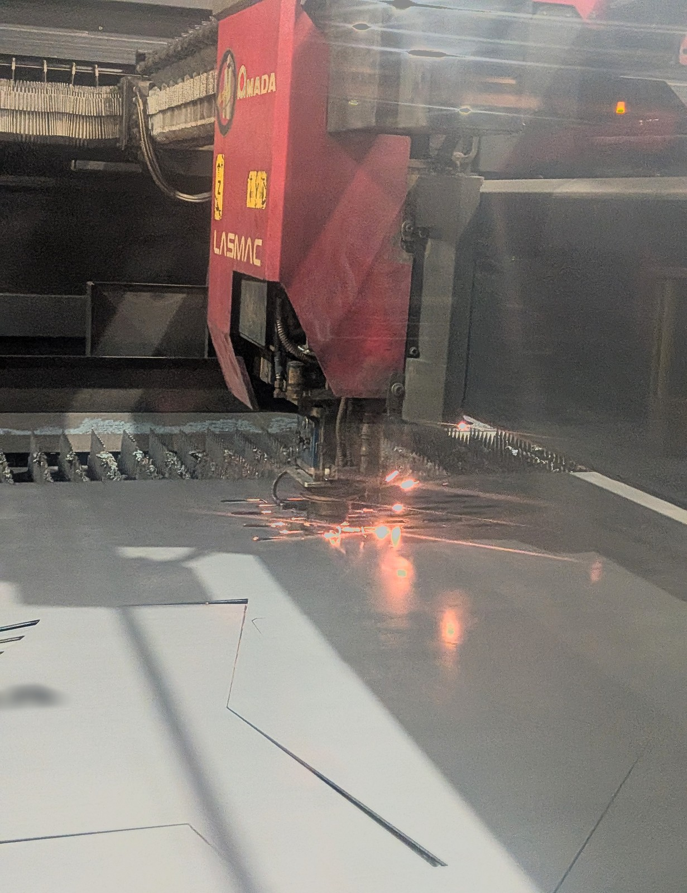
  </a>
  <figcaption class="photo-caption"><em>Amada LASMAC cutting head on the FO 4020NT, at work.</em></figcaption>
</figure>

<figure class="photo-tile">
  <a href="../projects/images/amada-4020-operator-console.jpg" title="Open the full-size photo">
    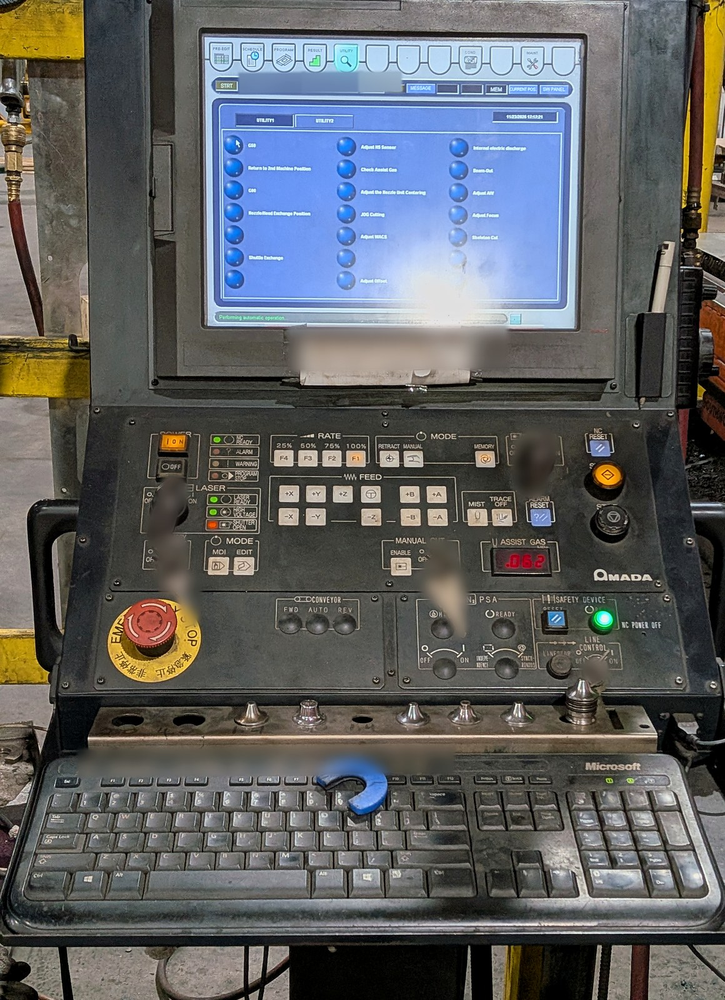
  </a>
  <figcaption class="photo-caption"><em>Operator console on the Amada FO 4020NT.</em></figcaption>
</figure>

<figure class="photo-tile">
  <a href="../projects/images/amada-4020-output-side.jpg" title="Open the full-size photo">
    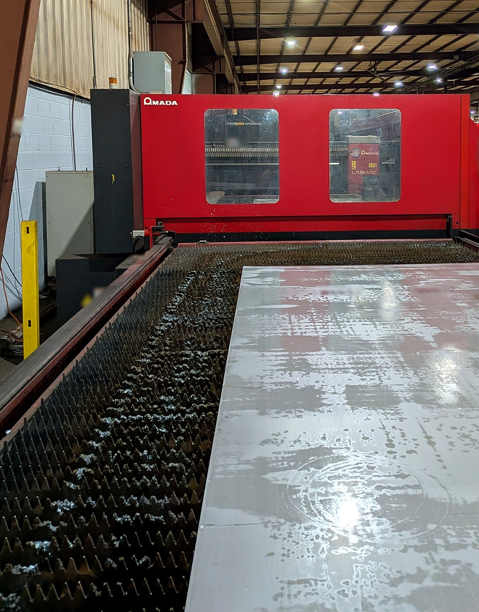
  </a>
  <figcaption class="photo-caption"><em>Output side of the Amada FO 4020NT, with a fresh sheet on the shuttle table.</em></figcaption>
</figure>

<figure class="photo-tile">
  <a href="../projects/images/fo-4020nt-nozzle.jpg" title="Open the full-size photo">
    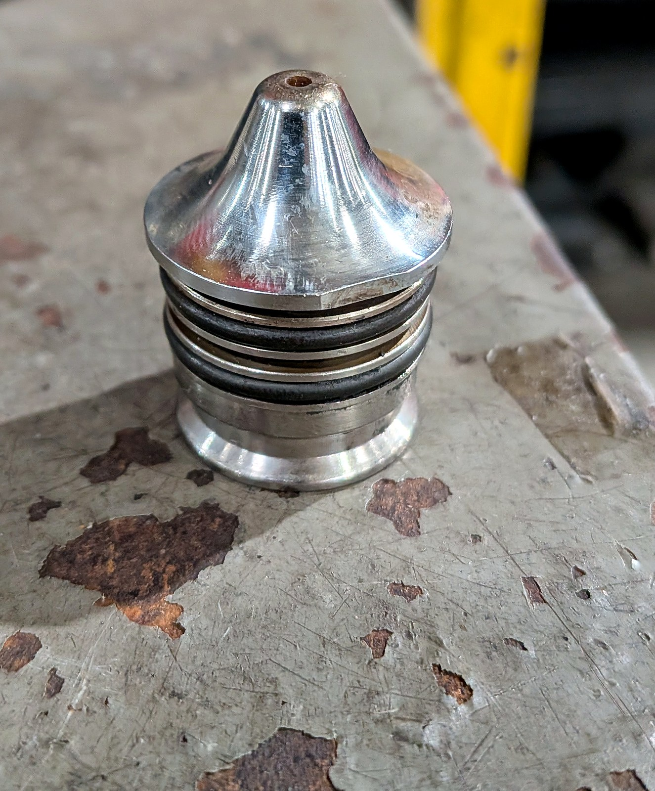
  </a>
  <figcaption class="photo-caption"><em>Cutting nozzle for the Amada FO 4020NT laser.</em></figcaption>
</figure>

<figure class="photo-tile">
  <a href="../projects/images/nozzle-change-tools.jpg" title="Open the full-size photo">
    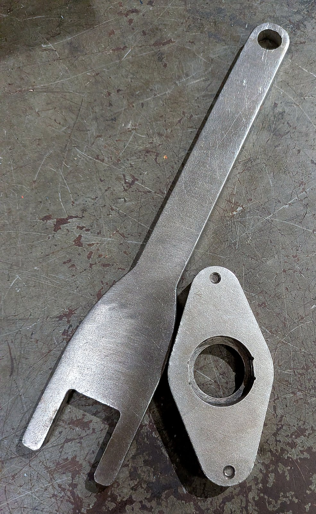
  </a>
  <figcaption class="photo-caption"><em>Nozzle change tools for the Amada lasers.</em></figcaption>
</figure>

<figure class="photo-tile">
  <a href="../projects/images/fo-4020nt-ros-table.jpg" title="Open the full-size photo">
    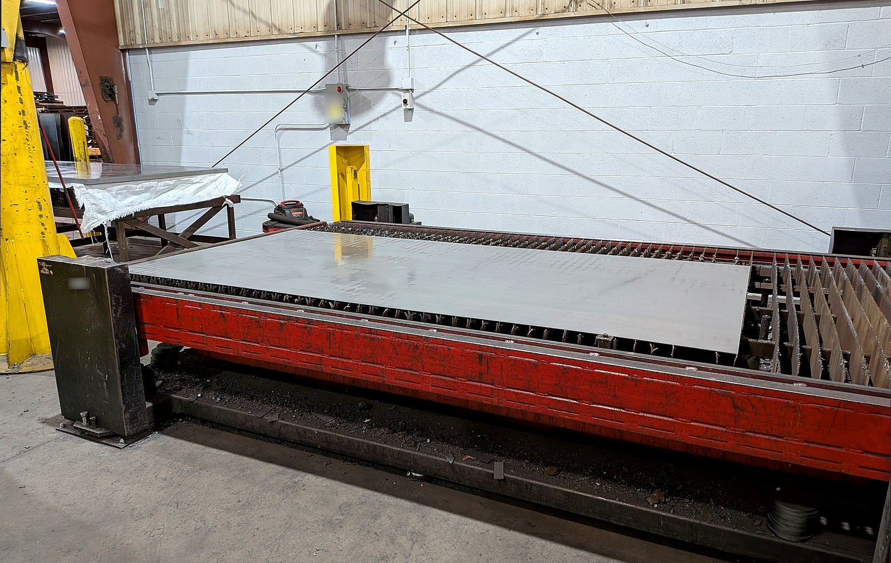
  </a>
  <figcaption class="photo-caption"><em>ROS table on the Amada FO 4020NT, with a fresh sheet on the slats.</em></figcaption>
</figure>

<figure class="photo-tile">
  <a href="../projects/images/ams-4020-cl.jpg" title="Open the full-size photo">
    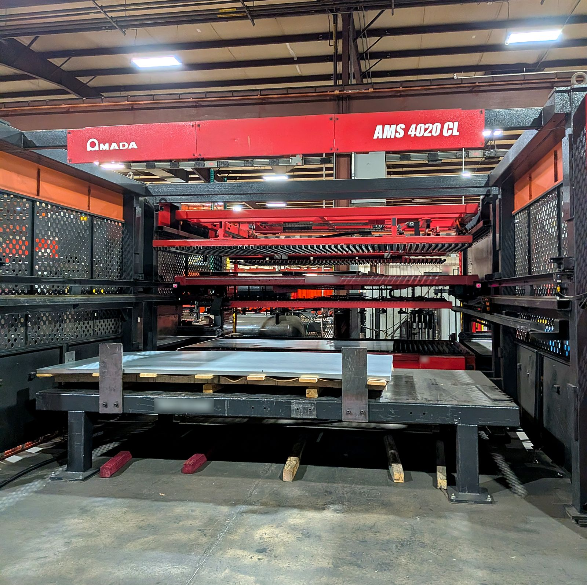
  </a>
  <figcaption class="photo-caption"><em>Amada AMS 4020 CL automation with a fresh sheet on the load table.</em></figcaption>
</figure>

<figure class="photo-tile">
  <a href="../projects/images/ams-4020-cl-ros-table.jpg" title="Open the full-size photo">
    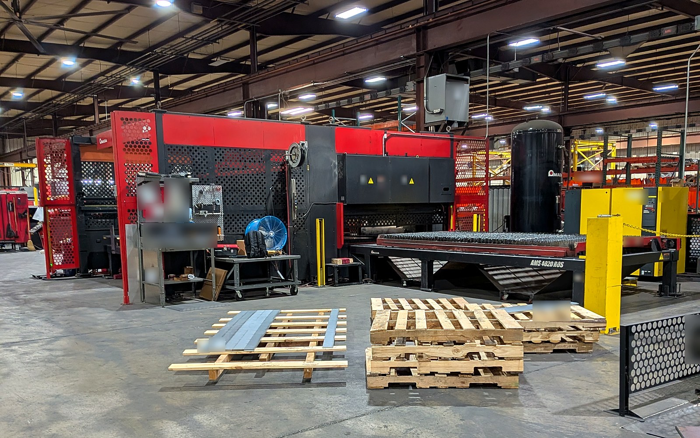
  </a>
  <figcaption class="photo-caption"><em>Amada AMS 4020 CL automation with its ROS table.</em></figcaption>
</figure>

<figure class="photo-tile">
  <a href="../projects/images/amada-3015-6k-cutting.mp4" title="Play the video (MP4)">
    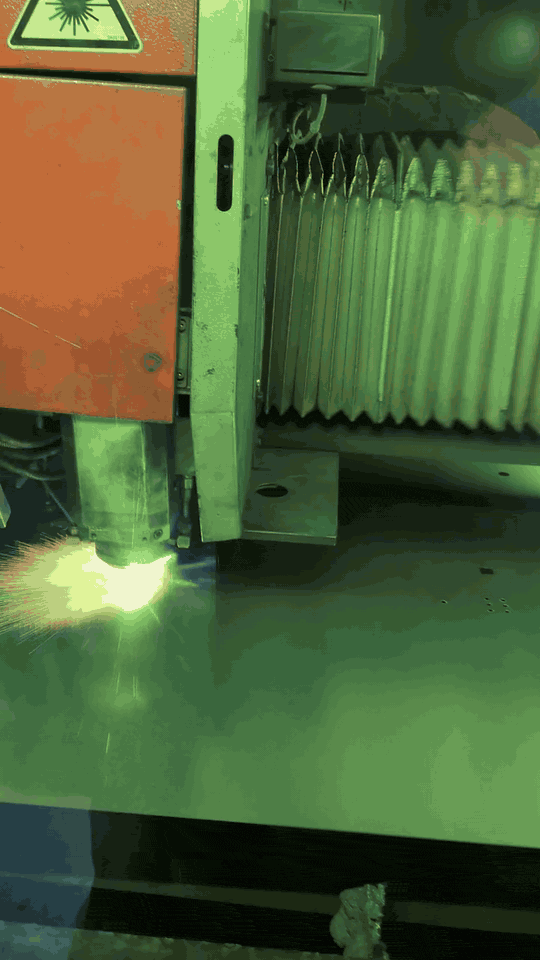
  </a>
  <figcaption class="photo-caption"><em>Amada 3015 6kW laser cutting.</em></figcaption>
</figure>

<figure class="photo-tile">
  <a href="../projects/images/liberty-systems-nitrogen-generator.jpg" title="Open the full-size photo">
    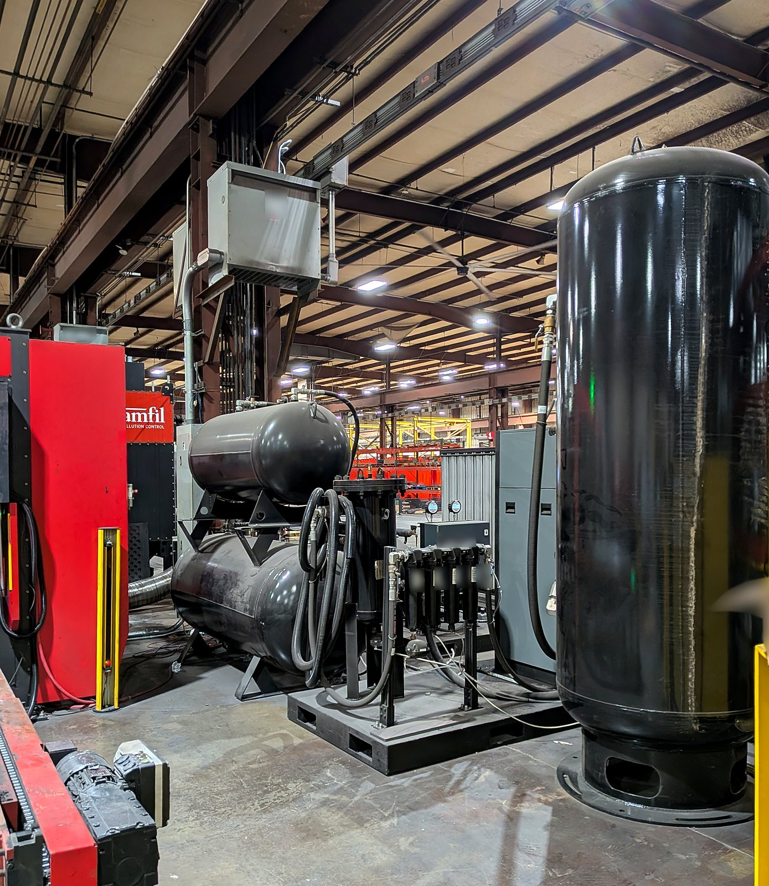
  </a>
  <figcaption class="photo-caption"><em>Tanks and filters for the Liberty Systems nitrogen generator.</em></figcaption>
</figure>

<figure class="photo-tile">
  <a href="../projects/images/liberty-systems-nitrogen-generator-unit.jpg" title="Open the full-size photo">
    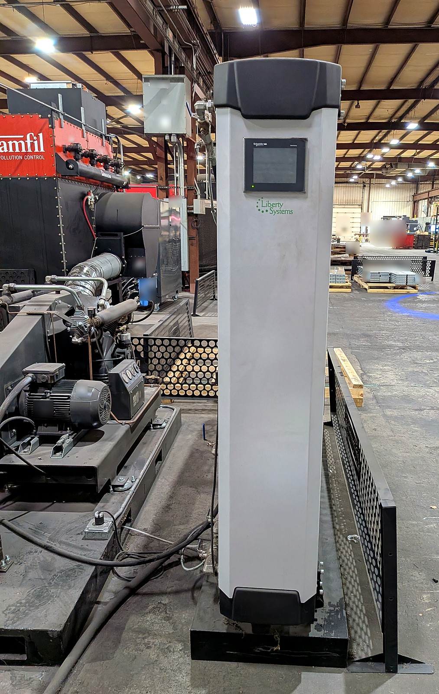
  </a>
  <figcaption class="photo-caption"><em>Liberty Systems nitrogen generator in the shop.</em></figcaption>
</figure>

<figure class="photo-tile">
  <a href="../projects/images/amada-esd-unit.jpg" title="Open the full-size photo">
    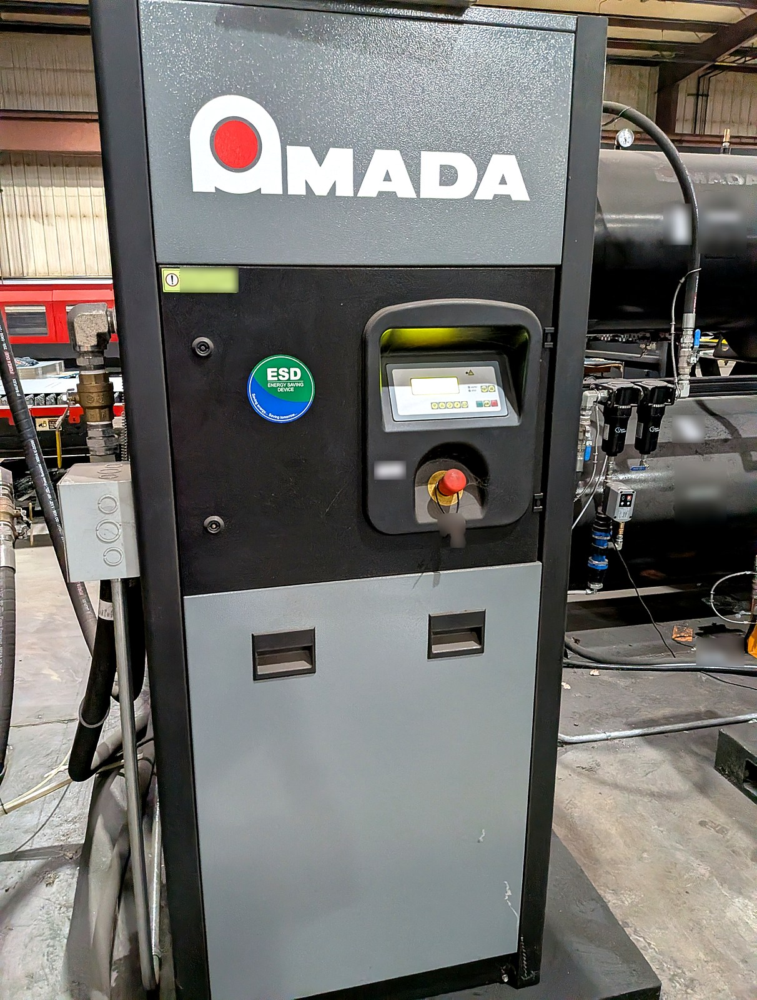
  </a>
  <figcaption class="photo-caption"><em>Amada ESD (Energy Saving Device) unit in the shop.</em></figcaption>
</figure>

Write-ups for parts 01–04 are on the [projects](../projects/) page.

  

⬅️ <a href="../">Back to my portfolio</a>

<a href="#top">↑ Back to top</a>

  

