

  

  <a href="../">🏠 Home</a> &nbsp;·&nbsp;
  <a href="../projects/">Projects</a> &nbsp;·&nbsp;
  <a href="../gallery/">Gallery</a> &nbsp;·&nbsp;
  <a href="../machines/">Machines</a> &nbsp;·&nbsp;
  <a href="../resume/">Resume</a> &nbsp;·&nbsp;
  <a href="../how-it-works/">How It Works</a>

<h1 align="center">⚙️ How a Laser Job Runs</h1>

<strong>This page is a simple walk-through for shop bosses and recruiters who have never stood next to a laser.</strong>

  
  
  
  

  

  
I work at <a href="https://www.metalworkingsolutions.com/">Metalworking Solutions</a>. I do CNC laser programming, and I run the lasers too, including machines with full automation. CNC means the machine follows a computer program. I cut stainless steel, aluminum, and HRPO, which is hot rolled pickled and oiled steel, usually from 10 gauge to 16 gauge. Gauge is a number that stands for how thick the sheet is.

  
A laser job usually follows four steps: the nest, the cut, the skeleton, and, on a machine with a tower, the loading and unloading that keeps the job moving.

  
<em>Click any photo to zoom in.</em>

  

    1
    <h2>The nest</h2>
  

  
A nest is the layout of parts on a metal sheet. A sheet is a flat piece of metal. Before the laser starts, the parts are arranged on that sheet so they fit well and less material is wasted.

  
A laser job usually starts with a nest. A nest is usually checked before it runs, so the right parts, material, and thickness are on the sheet, and so no part hangs off the edge.

  

    📐 From my Quick Reference
    
<strong>Review the nest before it runs.</strong> Check quantity, material, thickness, grain, lead-ins, tabs, and that no part hangs off the sheet. <a href="../tips/">See all the tips</a>

  

  
If you want a longer explanation of how a nest is laid out, <a href="https://www.thefabricator.com/thefabricator/article/lasercutting/nesting-fundamentals-for-laser-cutting-stability">The Fabricator has an article on nesting fundamentals</a>, by Tim Heston. It is already on my <a href="../resources/HELPFUL_LINKS.html">Helpful Links</a> page.

  

    <figure class="photo-tile">
      <a href="../projects/images/nest-printout.jpg" title="Open the full-size photo">
        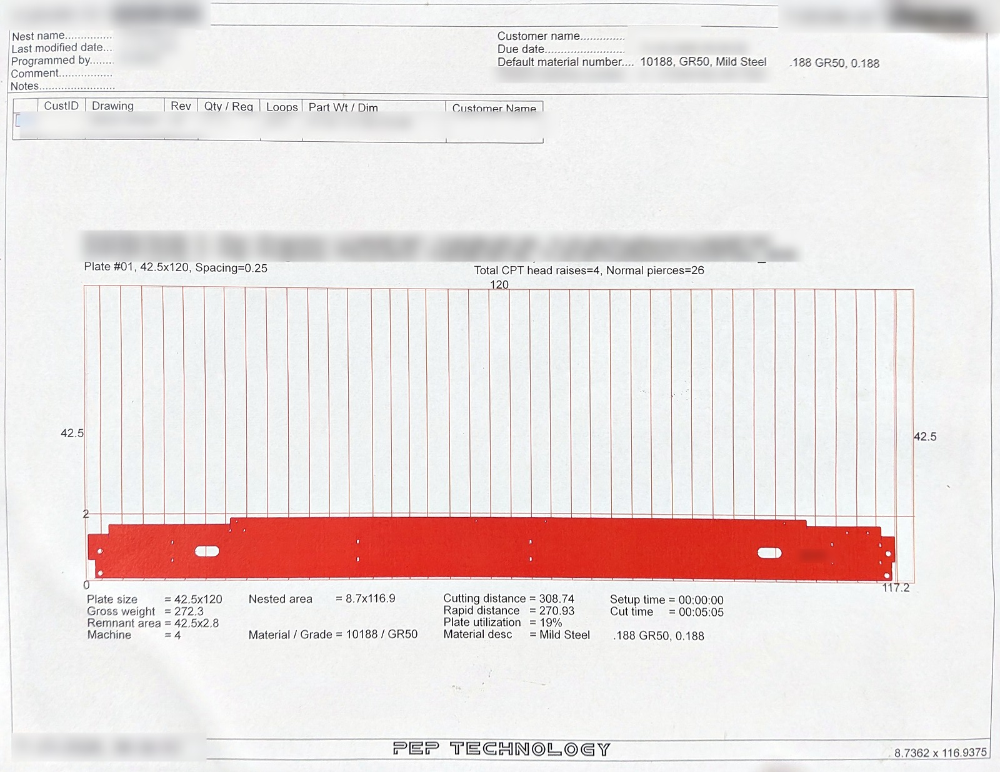
      </a>
      <figcaption class="photo-caption"><em>A nest printout: parts laid out on a 42.5 x 120 inch sheet to save metal.</em></figcaption>
    </figure>
    <figure class="photo-tile">
      <a href="../projects/images/nest-control-screen.jpg" title="Open the full-size photo">
        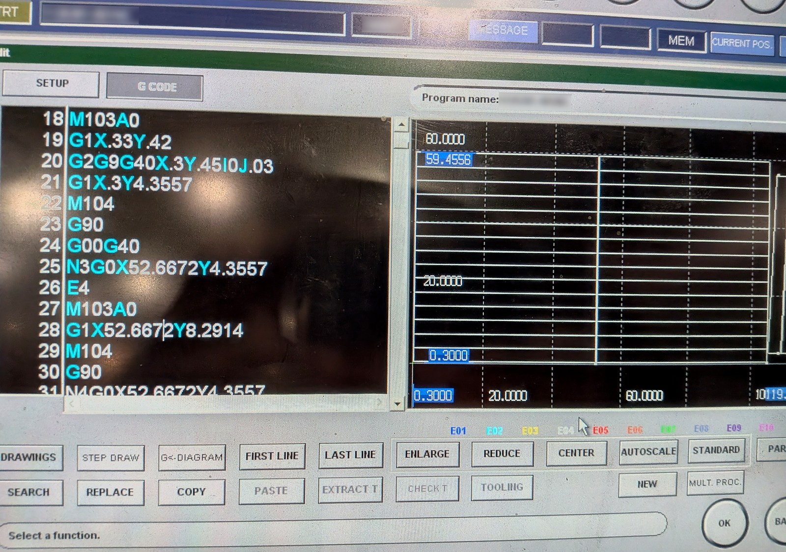
      </a>
      <figcaption class="photo-caption"><em>The cutting program and nest layout on the laser&#x27;s control screen.</em></figcaption>
    </figure>
  

  

    2
    <h2>The cut</h2>
  

  
Once the nest is ready, the laser cuts the parts out of the sheet. The cutting head is the part of the machine that does the cutting. It follows the paths in the program and cuts each part.

  
Here is what that looks like on the lasers I run.

  
The sheet often sits on a shuttle table, which is a moving table that carries the sheet in and out of the laser.

  

    <figure class="photo-tile">
      <a href="../projects/images/amada-4020-laser-head.jpg" title="Open the full-size photo">
        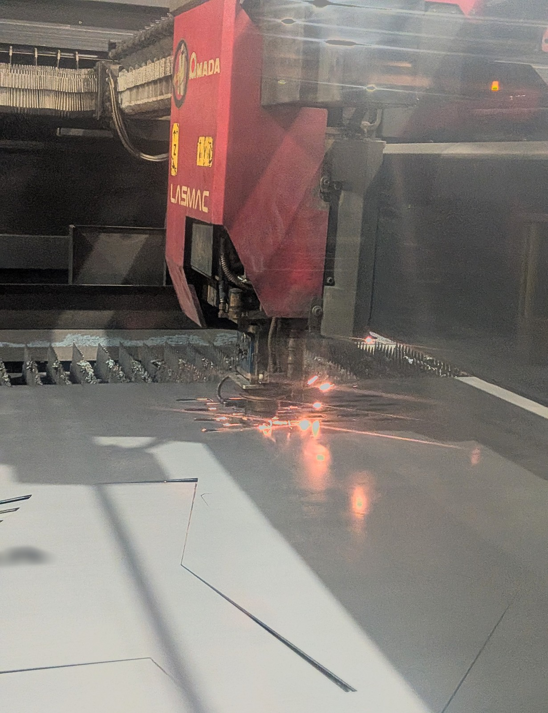
      </a>
      <figcaption class="photo-caption"><em>Amada LASMAC cutting head on the FO 4020NT, at work.</em></figcaption>
    </figure>
    <figure class="photo-tile">
      <a href="../projects/images/amada-3015-6k-cutting.mp4" title="Play the video (MP4)">
        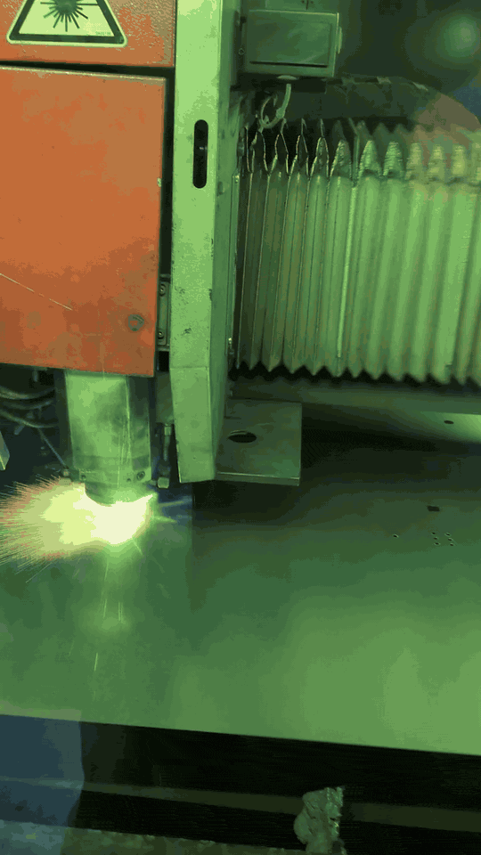
      </a>
      <figcaption class="photo-caption"><em>Amada 3015 6kW laser cutting.</em></figcaption>
    </figure>
    <figure class="photo-tile">
      <a href="../projects/images/amada-4020-output-side.jpg" title="Open the full-size photo">
        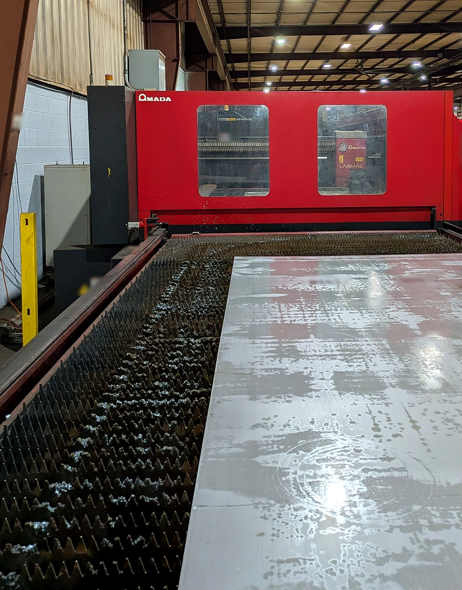
      </a>
      <figcaption class="photo-caption"><em>Output side of the Amada FO 4020NT, with a fresh sheet on the shuttle table.</em></figcaption>
    </figure>
    <figure class="photo-tile">
      <a href="../projects/images/amada-4020-operator-console.jpg" title="Open the full-size photo">
        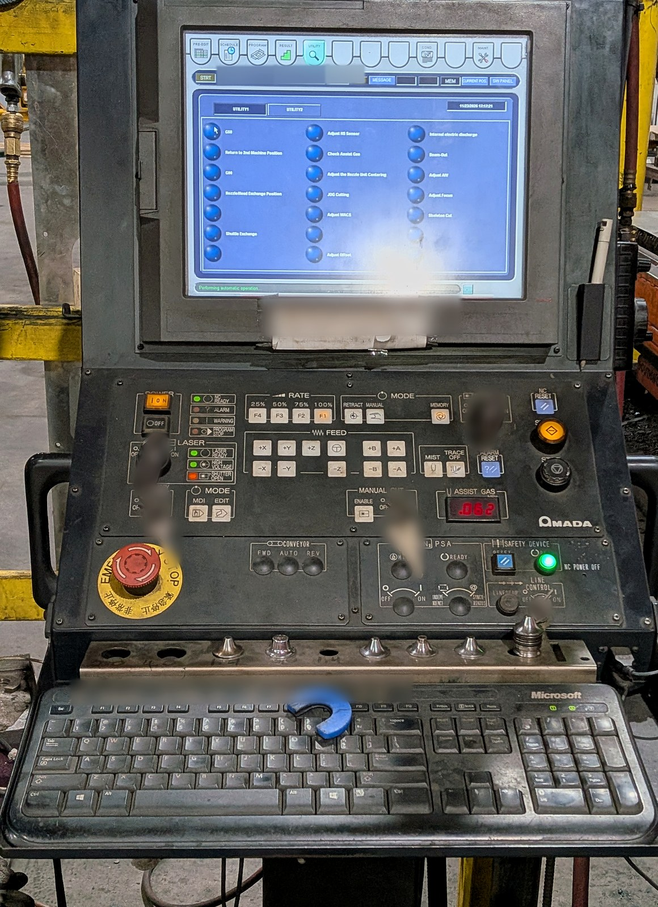
      </a>
      <figcaption class="photo-caption"><em>Operator console on the Amada FO 4020NT.</em></figcaption>
    </figure>
  

  

    3
    <h2>The skeleton</h2>
  

  
After the parts are cut out, a frame of leftover metal is still on the table. That leftover frame is called a skeleton.

  
The first photo below is a skeleton from a nested run. The open spaces are where the parts used to be.

  
The cut parts are then taken off the sheet. Here are a few finished parts from jobs I have programmed and cut.

  

    <figure class="photo-tile">
      <a href="../projects/images/skeleton-12ga-hrpo.jpg" title="Open the full-size photo">
        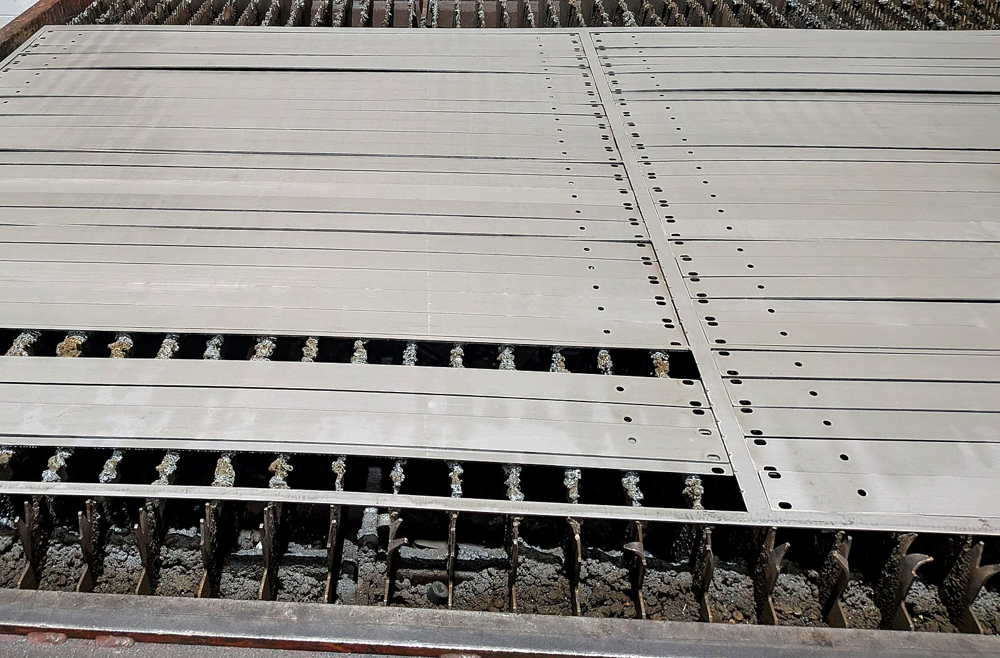
      </a>
      <figcaption class="photo-caption"><em>12 gauge HRPO (hot-rolled, pickled and oiled) skeleton after a nested run on the laser.</em></figcaption>
    </figure>
    <figure class="photo-tile">
      <a href="../projects/images/slider-door-latch-12ga.jpg" title="Open the full-size photo">
        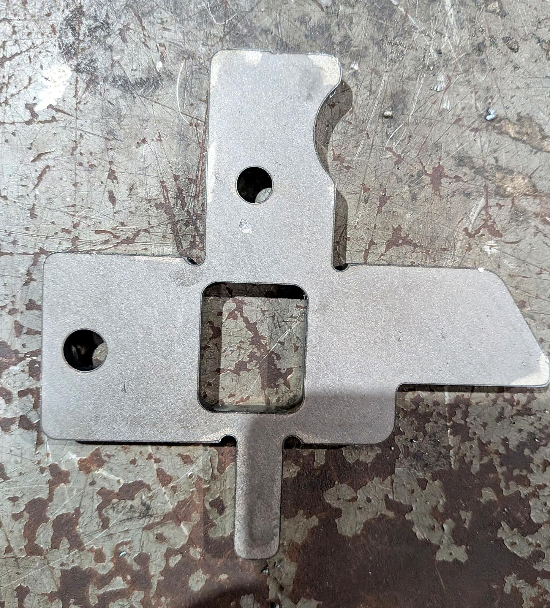
      </a>
      <figcaption class="photo-caption"><em>Slider door latch cut from 12 gauge steel on the Amada FO 4020NT.</em></figcaption>
    </figure>
    <figure class="photo-tile">
      <a href="../projects/images/galvanized-strips-16ga.jpg" title="Open the full-size photo">
        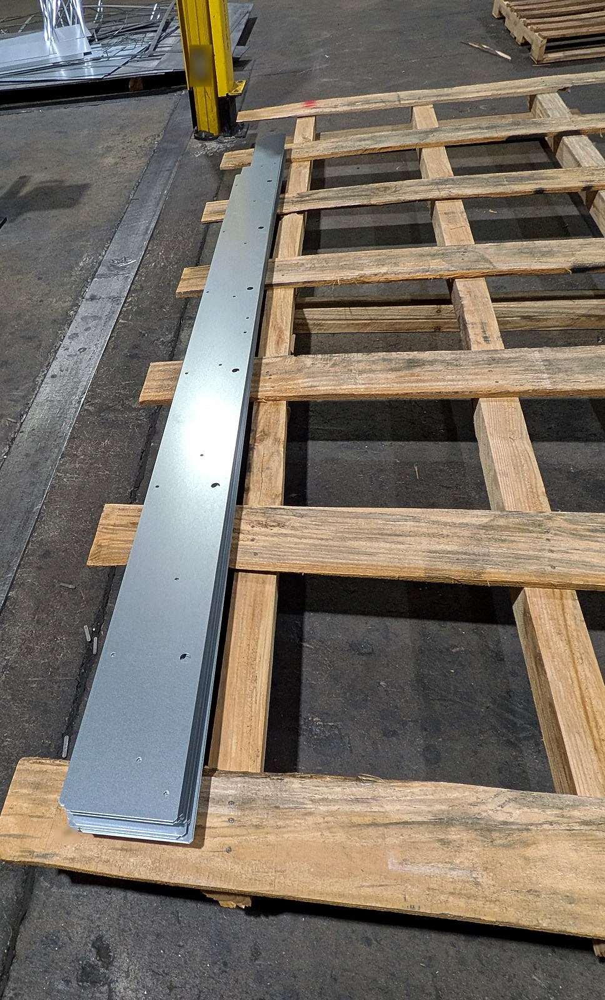
      </a>
      <figcaption class="photo-caption"><em>16 gauge galvanized strips cut on the laser.</em></figcaption>
    </figure>
  

  

    4
    <h2>How the tower keeps the job moving</h2>
  

  
On some of the lasers I run, a load and unload tower does the heavy lifting of moving sheets. The tower I run is an Amada AS LUL 3015. A load and unload tower is a tall rack that holds metal sheets and can move them on and off the laser.

  
The tower has 7 material shelves, 3 cutting shelves, and 1 finished-goods shelf. The 3 cutting shelves allow continuous loading and unloading when running large jobs. That means a new sheet can be going in while a finished sheet is coming off, so a large job can keep running.

  

    <figure class="photo-tile">
      <a href="../assets/tower-as-lul.jpg" title="Open the full-size photo">
        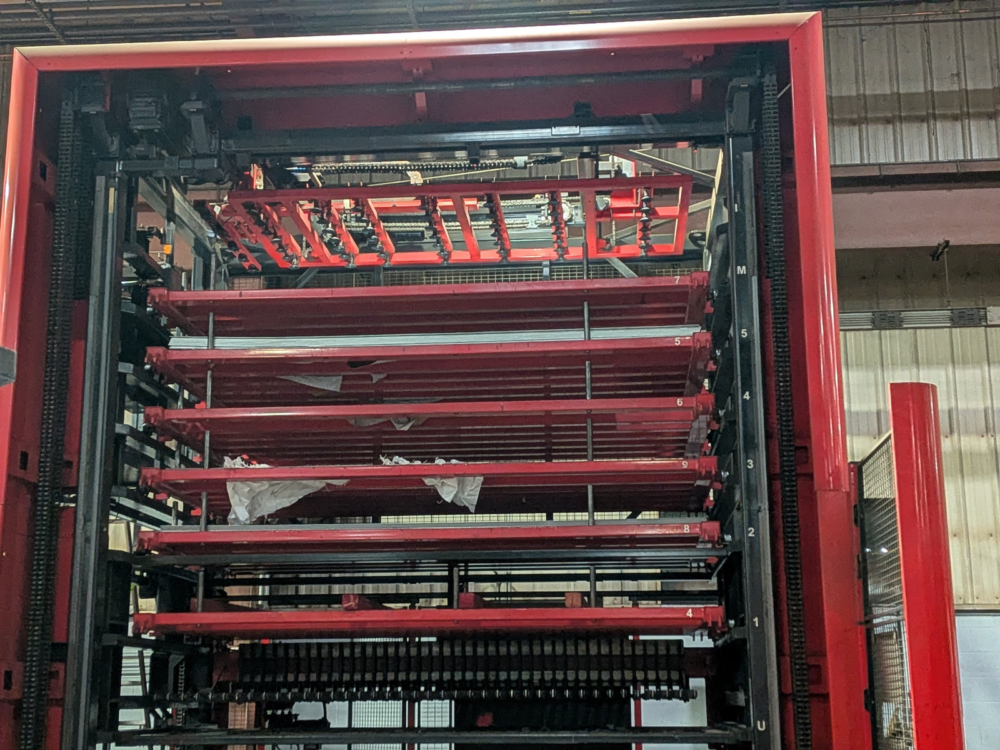
      </a>
      <figcaption class="photo-caption"><em>Amada AS LUL 3015 tower automation (photo I took at work)</em></figcaption>
    </figure>
    <figure class="photo-tile">
      <a href="../projects/images/amada-as-lul-3015-table-clearing.jpg" title="Open the full-size photo">
        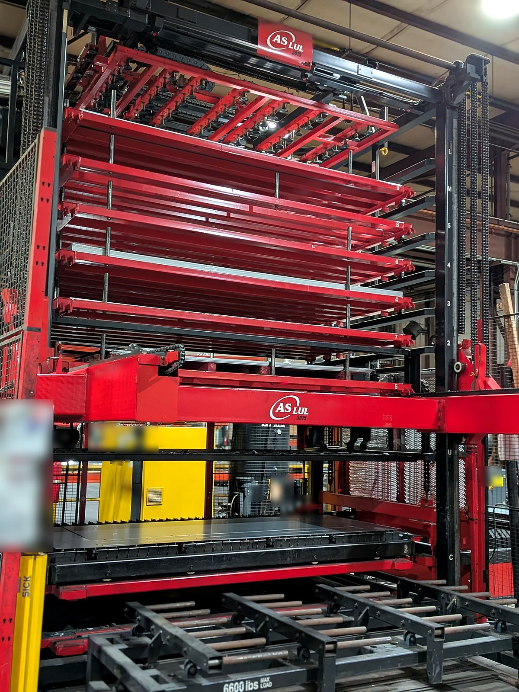
      </a>
      <figcaption class="photo-caption"><em>Amada AS LUL 3015 load/unload tower waiting for table clearing.</em></figcaption>
    </figure>
    <figure class="photo-tile">
      <a href="../assets/machine-3015-4k.jpg" title="Open the full-size photo">
        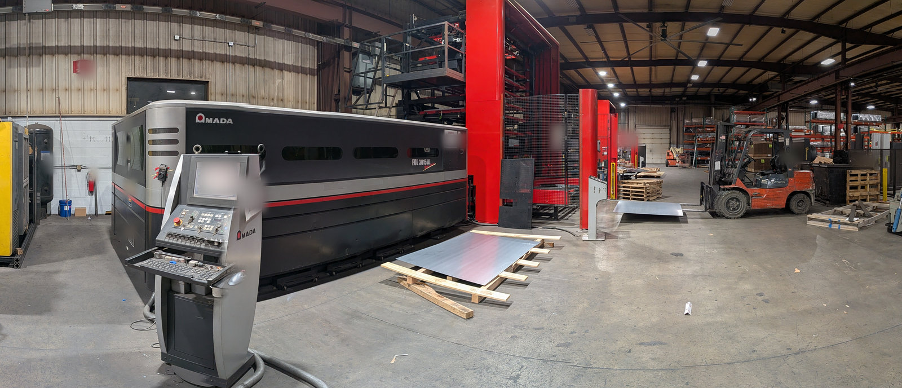
      </a>
      <figcaption class="photo-caption"><em>Amada 3015 4kW laser with automation (photo I took at work)</em></figcaption>
    </figure>
  

  
That is the usual path of a laser job, from the nest, through the cut, to the skeleton, and back through the tower for the next sheet.

  
You can see more photos, the machines I run, and my resume on my website: the <a href="../gallery/">Photo Gallery</a>, <a href="../machines/">Machines I Run</a> and <a href="../resume/">Resume</a> pages. The <a href="../machines/#official-amada-pages">official Amada pages</a> for the equipment are linked on Machines I Run.

  

⬅️ <a href="../">Back to my portfolio</a>

<a href="#top">↑ Back to top</a>

  

