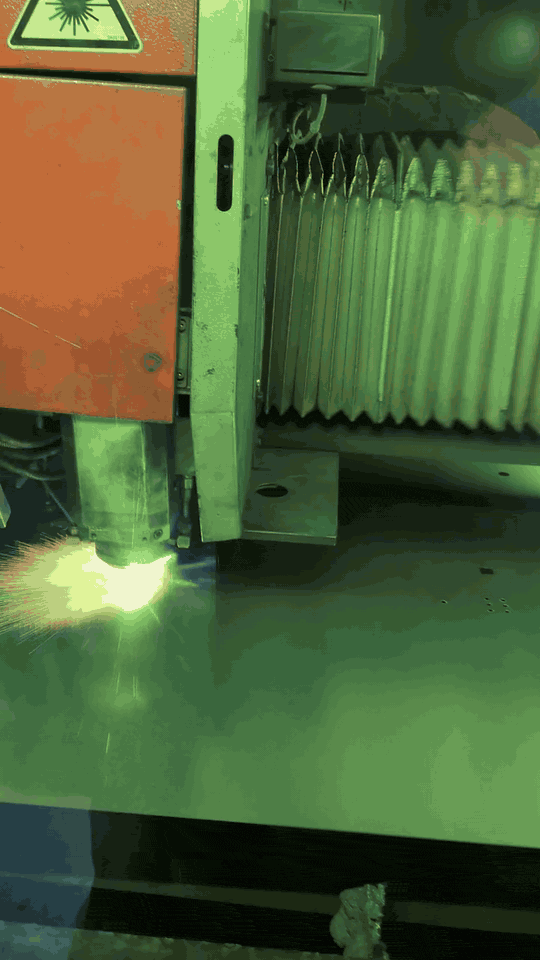
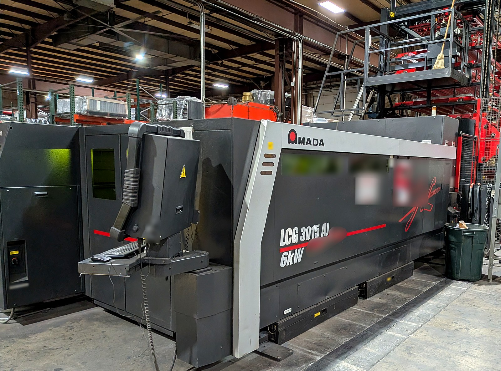
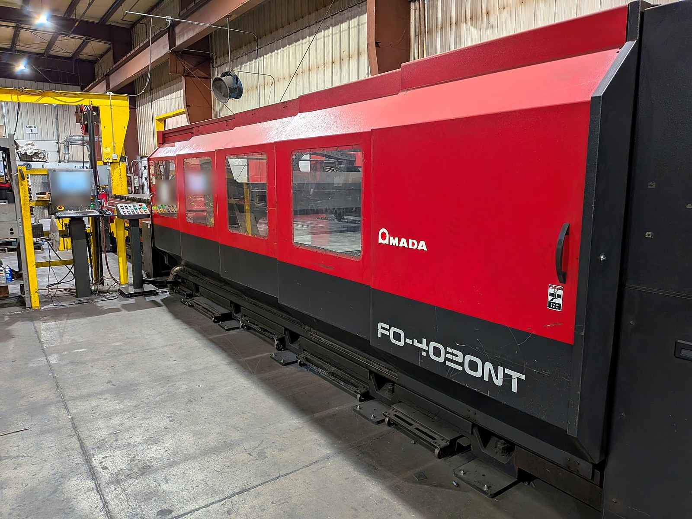
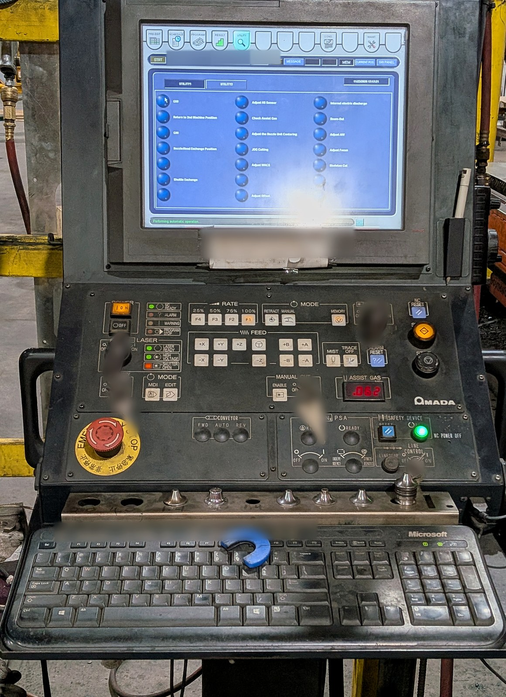
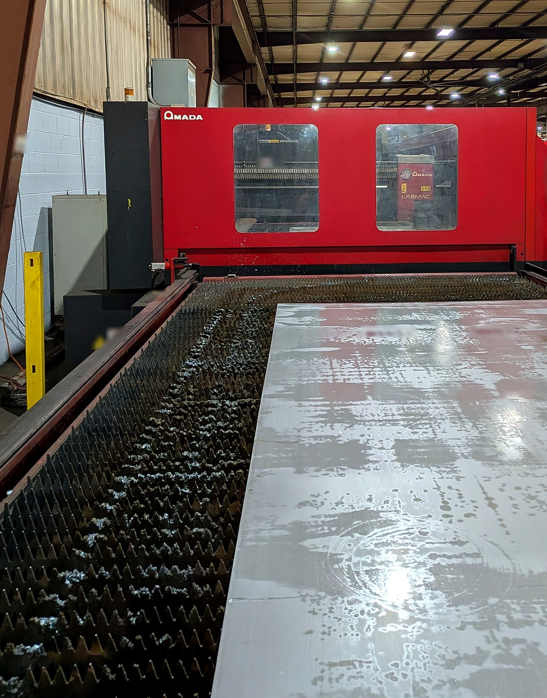
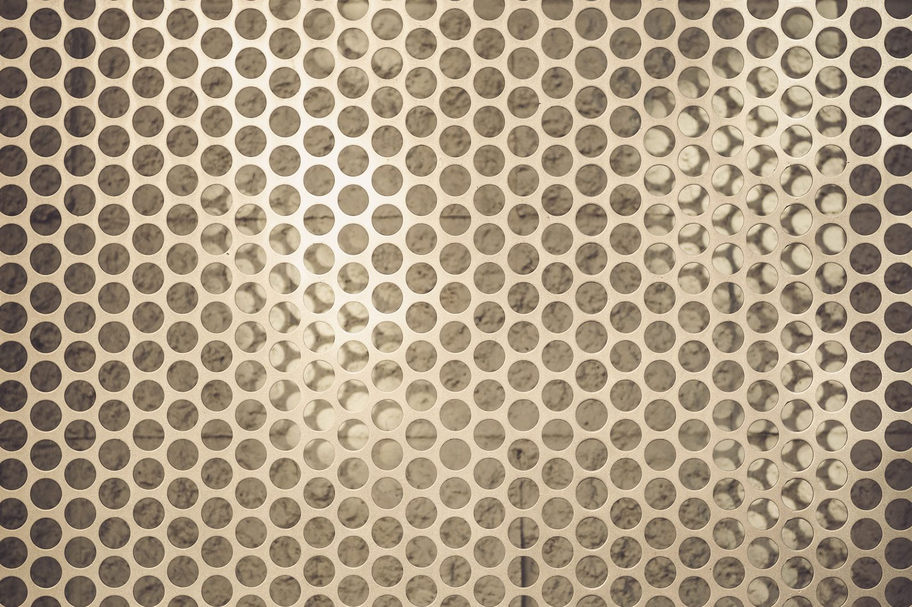
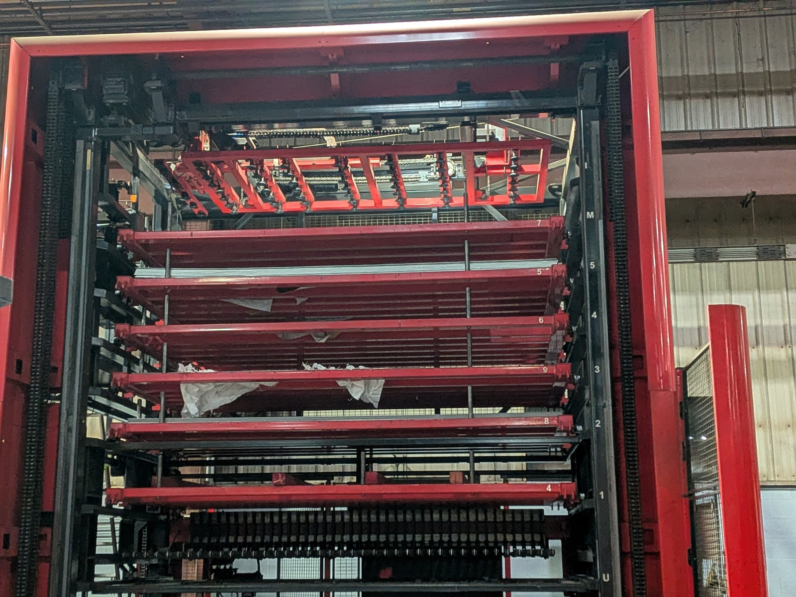
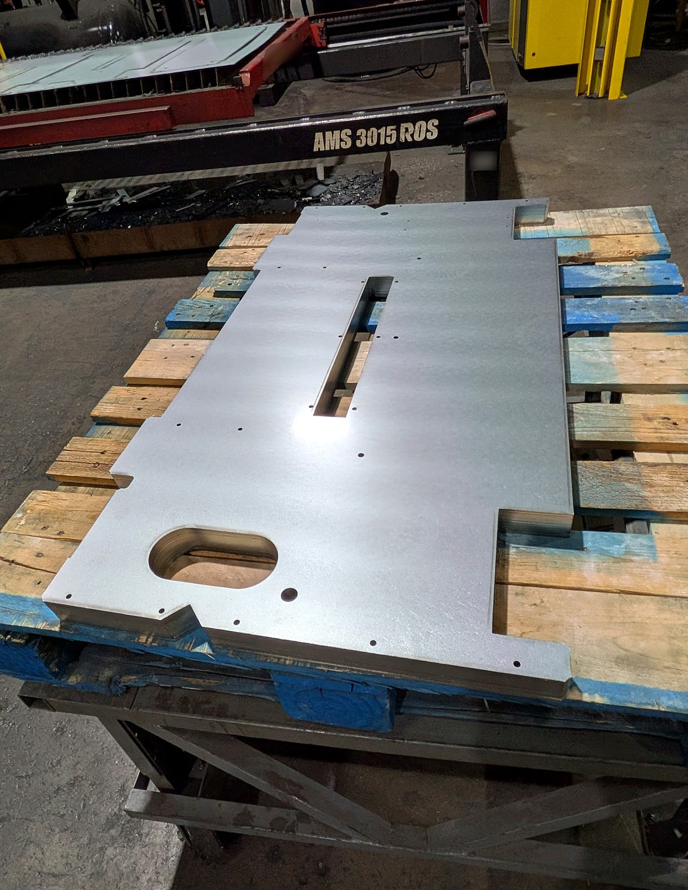

  

  <a href="../">🏠 Home</a> &nbsp;·&nbsp;
  <a href="../projects/">Projects</a> &nbsp;·&nbsp;
  <a href="../gallery/">Gallery</a> &nbsp;·&nbsp;
  <a href="../machines/">Machines</a> &nbsp;·&nbsp;
  <a href="../resume/">Resume</a> &nbsp;·&nbsp;
  <a href="../how-it-works/">How It Works</a>

<h1 align="center">🏭 Machines I Run</h1>

<strong>Amada lasers: 3015 and 4020 beds, 4kW, 6kW and 15kW, F1, with full automation</strong>

  
  
  
  
  

At <a href="https://www.metalworkingsolutions.com/">Metalworking Solutions</a>, I do CNC laser programming and I run the lasers, including machines with full automation. I cut stainless steel, aluminum, and HRPO (hot rolled pickled and oiled) steel, usually from 10 gauge to 16 gauge.

<em>Click any photo to zoom in.</em>

<figure class="stock-photo stock-banner">
  
  Stock photo
  <figcaption class="stock-credit">Stock photo: coiled sheet metal in a factory. <a href="https://www.pexels.com/photo/industrial-metal-rolls-in-a-factory-setting-37598393/">Photo by Nithina Palanisamy on Pexels</a></figcaption>
</figure>

  

## 🔆 Lasers

  Amada 3015 4K
  

    
  

  

    
<em>Amada 3015 4K laser with automation (photo I took at work)</em>

  

  Amada 3015 6K
  

    
  

  

    
<em>Amada 3015 6K laser cutting.</em>

  

  Amada LCG 3015AJ 6kW
  

    
  

  

    
<em>Amada LCG 3015AJ 6kW laser cutter.</em>

  

  Amada FO-4020NT
  

    
  

  

    
<em>Amada FO-4020NT laser cutter in the shop.</em>

  

  Amada 4020
  

    
    
    
  

  

    
<em>Amada 4020 LASMAC cutting head at work.</em>

    
<em>Operator console on the Amada 4020 laser.</em>

    
<em>Output side of the Amada 4020 laser, with a fresh sheet on the shuttle table.</em>

  

  Amada F1
  <figure class="stock-photo stock-card">
    
    Stock photo
    <figcaption class="stock-credit">Stock photo: perforated metal sheet. <a href="https://www.pexels.com/photo/metallic-perforated-surface-with-circular-pattern-34996983/">Photo by Tim Mossholder on Pexels</a></figcaption>
  </figure>
  

    
<a href="https://www.amada.co.jp/english/products/bankin/laser/lc_f1_nt_series.html">F1 series</a> · <a href="https://www.amada.ca/laser-f1">Amada Canada</a>. There is not a current F1 product page on Amada America's website.

  

  

## 🤖 Automation

  Amada AS-LUL tower
  

    
  

  

    
<em>Amada AS-LUL tower automation (photo I took at work)</em>

    
The tower has 7 material shelves, 3 cutting shelves, and 1 finished-goods shelf. The 3 cutting shelves allow continuous loading and unloading when running large jobs.

  

  Amada AS-LUL 3015
  

    
  

  

    
<em>Amada AS-LUL 3015 load/unload tower waiting for table clearing.</em>

  

  Amada AMS 3015 ROS unloader
  

    
  

  

    
<em>14 gauge galvanized plate cut on the laser, with the Amada AMS 3015 ROS unloader in the background.</em>

  

  Full automation
  <figure class="stock-photo stock-card">
    
    Stock photo
    <figcaption class="stock-credit">Stock photo: painted metal sheet with cut holes. <a href="https://www.pexels.com/photo/textured-background-of-grunge-metal-wall-with-holes-4455007/">Photo by Brett Sayles on Pexels</a></figcaption>
  </figure>
  

    
<a href="https://www.amada.com/america/ams-3015-cl">AMS CL/CLT</a> · <a href="https://www.amada.com/america/blanking-automation">blanking automation</a>

  

  

## 🔗 Official Amada pages

The links below go to official Amada pages so you can see the equipment. I have not copied Amada's photos onto this page.

| What I run | Official Amada pages |
| :--- | :--- |
| **3015 and 4020 beds** | [ENSIS series](https://www.amada.com/america/ensis-series) · [VENTIS series](https://www.amada.com/america/ventis-aj) · [Laser Cutting Systems](https://www.amada.com/america/laser-cutting-systems) |
| **4kW, 6kW, and 15kW** | [ENSIS series](https://www.amada.com/america/ensis-series) (6kW and 15kW) · [VENTIS series](https://www.amada.com/america/ventis-aj) (6kW) · [F1 series](https://www.amada.co.jp/english/products/bankin/laser/lc_f1_nt_series.html) (4kW) |
| **F1** | [F1 series](https://www.amada.co.jp/english/products/bankin/laser/lc_f1_nt_series.html) · [Amada Canada](https://www.amada.ca/laser-f1). There is not a current F1 product page on Amada America's website. |
| **Full automation** | [AMS CL/CLT](https://www.amada.com/america/ams-3015-cl) · [blanking automation](https://www.amada.com/america/blanking-automation) |

  

⬅️ <a href="../">Back to my portfolio</a>

<a href="#top">↑ Back to top</a>

  

