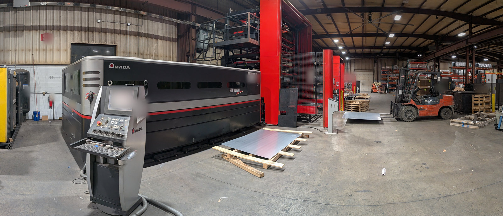
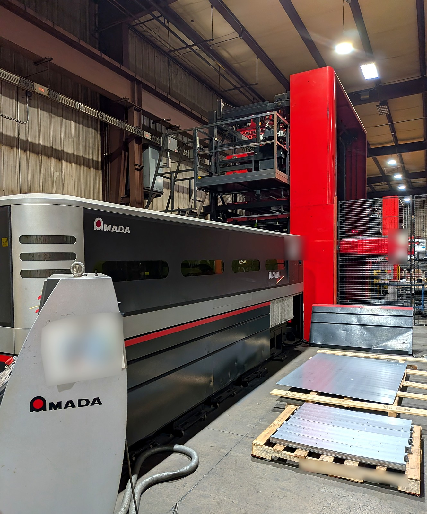
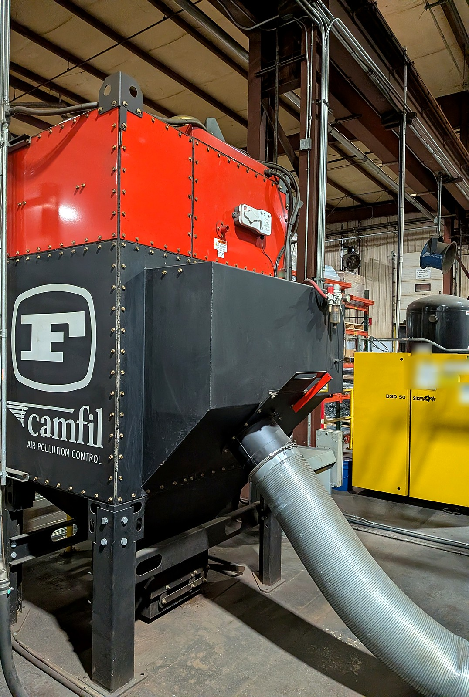
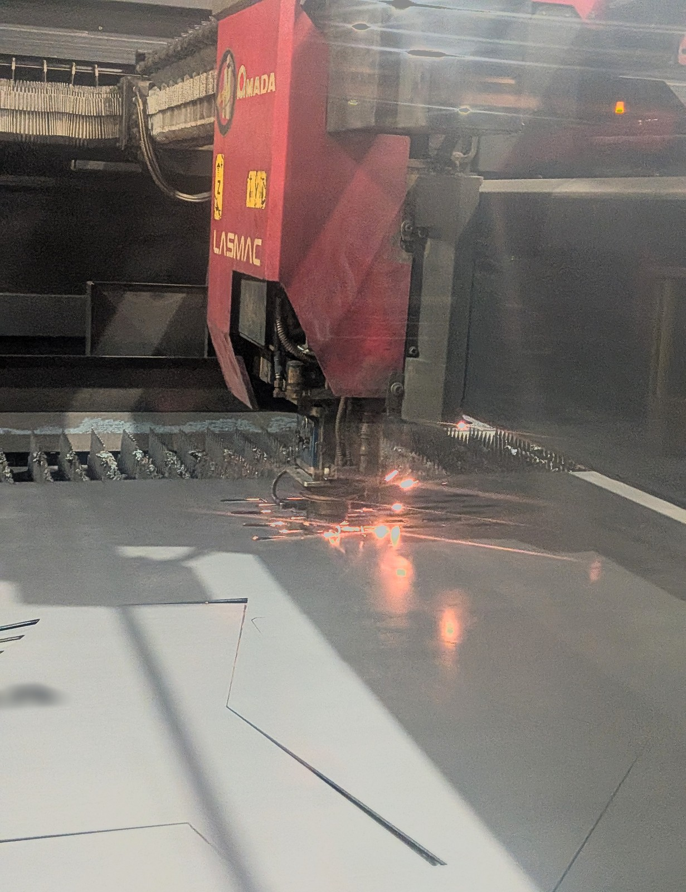
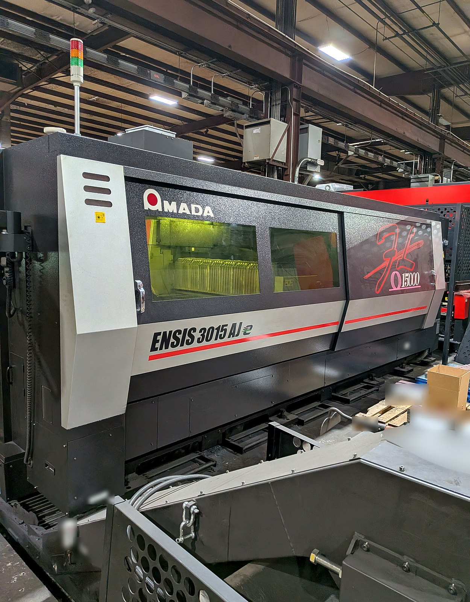
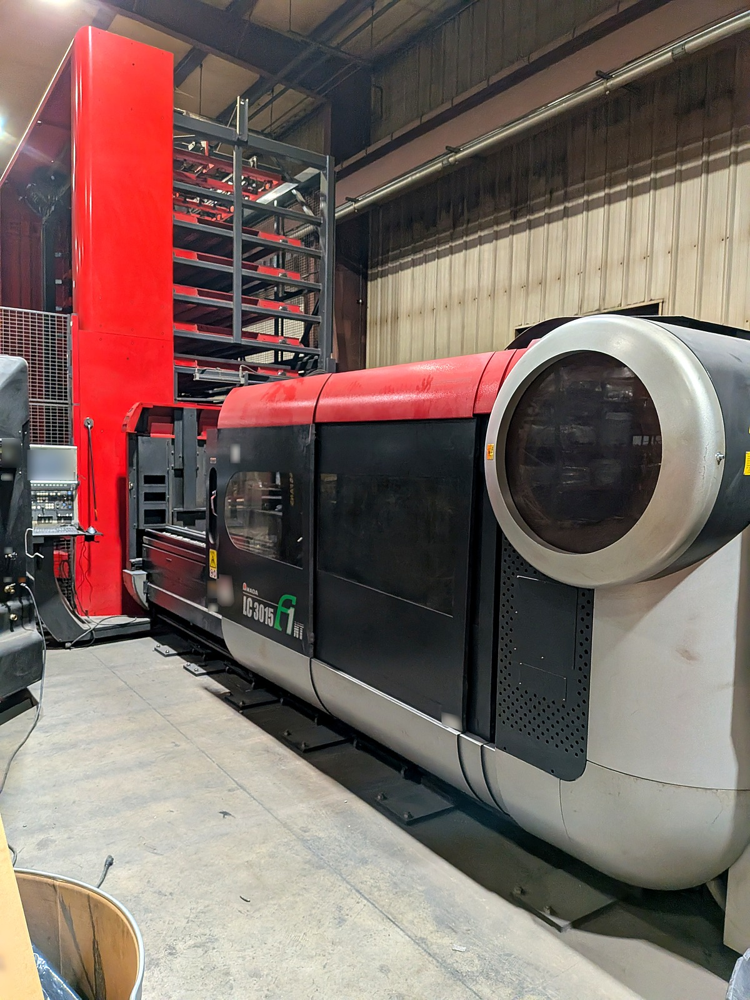
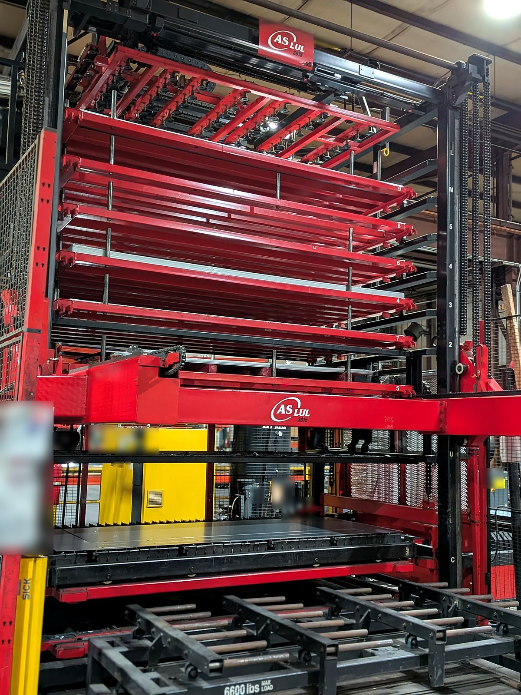
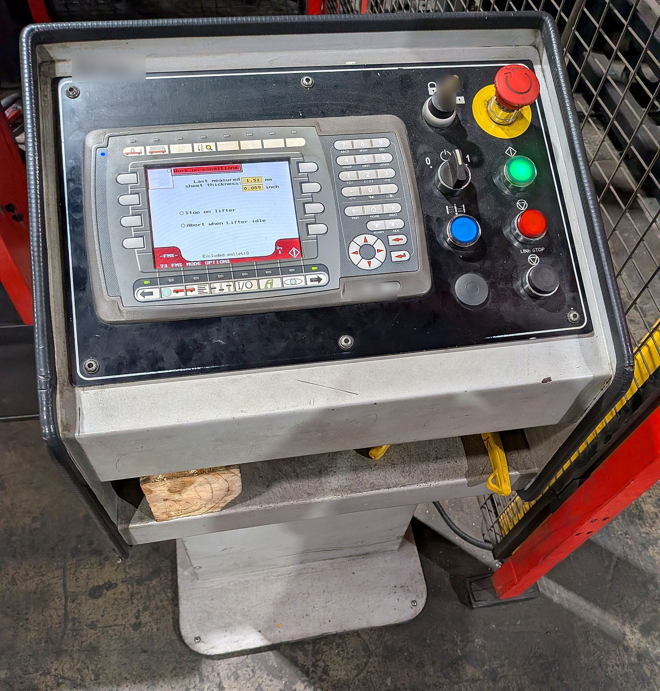
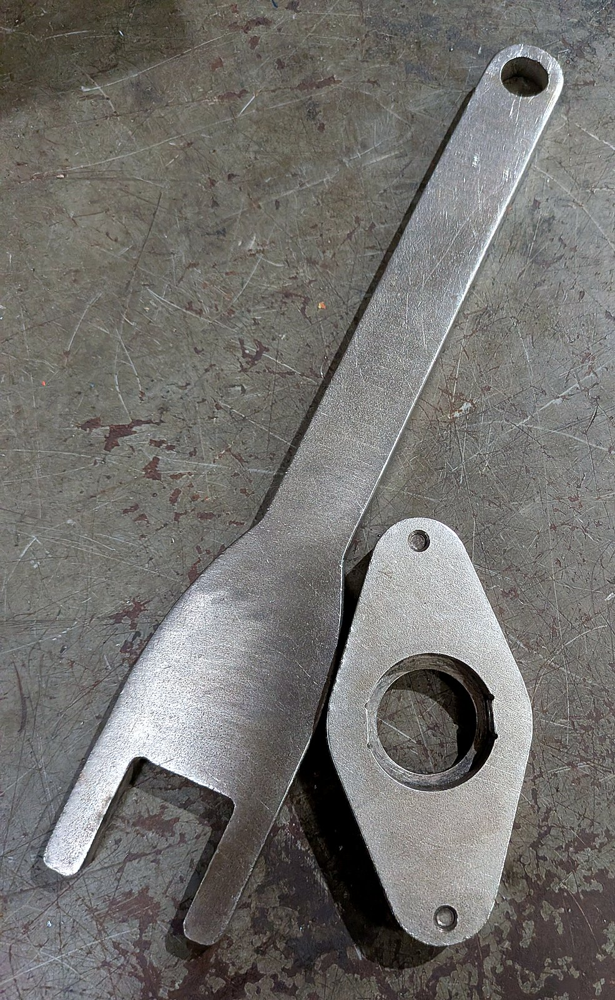
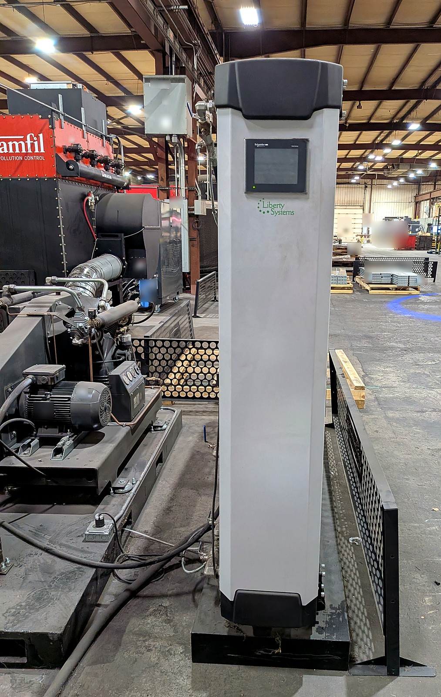

  

<h1 align="center">🏭 Machines I Run</h1>

<strong>Amada lasers: 3015 and 4020 beds, 4kW, 6kW and 15kW, F1, with full automation</strong>

  
  
  
  
  

At <a href="https://www.metalworkingsolutions.com/">Metalworking Solutions</a>, I do CNC laser programming and I run the lasers, including machines with full automation. I cut stainless steel, aluminum, HRPO (hot rolled pickled and oiled) steel, and galvanized steel, usually from 22 gauge sheet up to 10 gauge, and plate from 1/8 inch to 1 1/4 inch.

<em>Click any photo to zoom in.</em>

<figure class="stock-photo stock-banner">
  
  Stock photo
  <figcaption class="stock-credit">Stock photo: coiled sheet metal in a factory. <a href="https://www.pexels.com/photo/industrial-metal-rolls-in-a-factory-setting-37598393/">Photo by Nithina Palanisamy on Pexels</a></figcaption>
</figure>

  

## 🔆 Lasers

  Amada FOL 3015 AJ 4kW
  

    
    
  

  

    
<em>Amada FOL 3015 AJ 4kW laser with automation (photo I took at work)</em>

    
<em>Amada FOL 3015 AJ 4kW laser cutter with its automation tower.</em>

  

  Amada LCG 3015 AJ 6kW
  

    
    
    
    
    
  

  

    
<em>Amada LCG 3015 AJ 6kW laser cutter.</em>

    
<em>Amada 3015 6kW laser cutting.</em>

    
<em>AMNC 3i control on the Amada 3015 6kW laser.</em>

    
<em>Amada X-direction conveyor, which carries scrap and small parts out of the machine.</em>

    
<em>Camfil dust collector that pulls smoke and dust out of the Amada LCG 3015 AJ 6kW laser.</em>

  

  Amada FO 4020NT
  

    
    
    
    
    
    
  

  

    
<em>Amada FO 4020NT laser cutter in the shop.</em>

    
<em>Amada LASMAC cutting head on the FO 4020NT, at work.</em>

    
<em>Operator console on the Amada FO 4020NT.</em>

    
<em>Output side of the Amada FO 4020NT, with a fresh sheet on the shuttle table.</em>

    
<em>Cutting nozzle for the Amada FO 4020NT laser.</em>

    
<em>ROS table on the Amada FO 4020NT, with a fresh sheet on the slats.</em>

  

  Amada AMS 4020 CL
  

    
    
  

  

    
<em>Amada AMS 4020 CL automation with a fresh sheet on the load table.</em>

    
<em>Amada AMS 4020 CL automation with its ROS table.</em>

  

  Amada ENSIS 3015 AJ
  

    
  

  

    
<em>Amada ENSIS 3015 AJ laser cutting machine, with an FL 15000 badge.</em>

    
<a href="https://www.amada.com/america/ensis-series">ENSIS series</a> (official Amada page)

  

  Amada LC 3015 F1 NT
  

    
  

  

    
<em>Amada LC 3015 F1 NT laser cutter with its load/unload tower.</em>

    
<a href="https://www.amada.co.jp/english/products/bankin/laser/lc_f1_nt_series.html">F1 series</a> · <a href="https://www.amada.ca/laser-f1">Amada Canada</a>. There is not a current F1 product page on Amada America's website.

  

  

## 🤖 Automation

  Amada AS LUL 3015
  

    
    
    
    
  

  

    
<em>Amada AS LUL 3015 tower automation (photo I took at work)</em>

    
The tower has 7 material shelves, 3 cutting shelves, and 1 finished-goods shelf. The 3 cutting shelves allow continuous loading and unloading when running large jobs.

    
<em>Amada AS LUL 3015 load/unload tower waiting for table clearing.</em>

    
<em>Operator control panel on the Amada AS LUL 3015 load/unload tower.</em>

    
<em>Control terminal for the Amada AS LUL 3015 load/unload tower.</em>

  

  Amada AMS 3015 ROS table
  

    
  

  

    
<em>14 gauge galvanized plate cut on the laser, with the Amada AMS 3015 ROS table in the background.</em>

  

  Full automation
  <figure class="stock-photo stock-card">
    
    Stock photo
    <figcaption class="stock-credit">Stock photo: painted metal sheet with cut holes. <a href="https://www.pexels.com/photo/textured-background-of-grunge-metal-wall-with-holes-4455007/">Photo by Brett Sayles on Pexels</a></figcaption>
  </figure>
  

    
<a href="https://www.amada.com/america/ams-3015-cl">AMS CL/CLT</a> · <a href="https://www.amada.com/america/blanking-automation">blanking automation</a>

  

  

## 🧰 Shop Equipment

  

    
  

  

    
<em>Nozzle change tools for the Amada lasers.</em>

  

  

    
  

  

    
<em>Tanks and filters for the Liberty Systems nitrogen generator.</em>

  

  

    
  

  

    
<em>Liberty Systems nitrogen generator in the shop.</em>

  

  

    
  

  

    
<em>Amada ESD (Energy Saving Device) unit in the shop.</em>

  

  

## 🔗 Official Amada pages

The links below go to official Amada pages so you can see the equipment. I have not copied Amada's photos onto this page.

| What I run | Official Amada pages |
| :--- | :--- |
| **3015 and 4020 beds** | [ENSIS series](https://www.amada.com/america/ensis-series) · [VENTIS series](https://www.amada.com/america/ventis-aj) · [Laser Cutting Systems](https://www.amada.com/america/laser-cutting-systems) |
| **4kW, 6kW, and 15kW** | [ENSIS series](https://www.amada.com/america/ensis-series) (6kW and 15kW) · [VENTIS series](https://www.amada.com/america/ventis-aj) (6kW) · [F1 series](https://www.amada.co.jp/english/products/bankin/laser/lc_f1_nt_series.html) (4kW) |
| **F1** | [F1 series](https://www.amada.co.jp/english/products/bankin/laser/lc_f1_nt_series.html) · [Amada Canada](https://www.amada.ca/laser-f1). There is not a current F1 product page on Amada America's website. |
| **Full automation** | [AMS CL/CLT](https://www.amada.com/america/ams-3015-cl) · [blanking automation](https://www.amada.com/america/blanking-automation) |

  

⬅️ <a href="../">Back to my portfolio</a>

<a href="#top">↑ Back to top</a>

  

