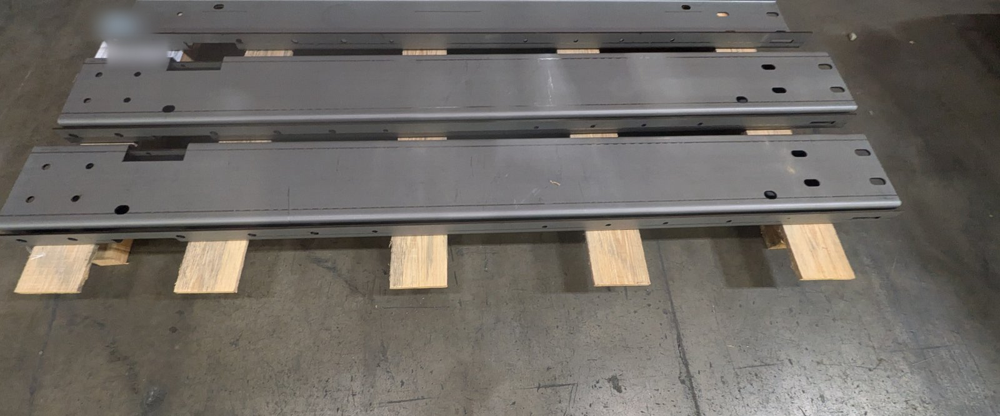
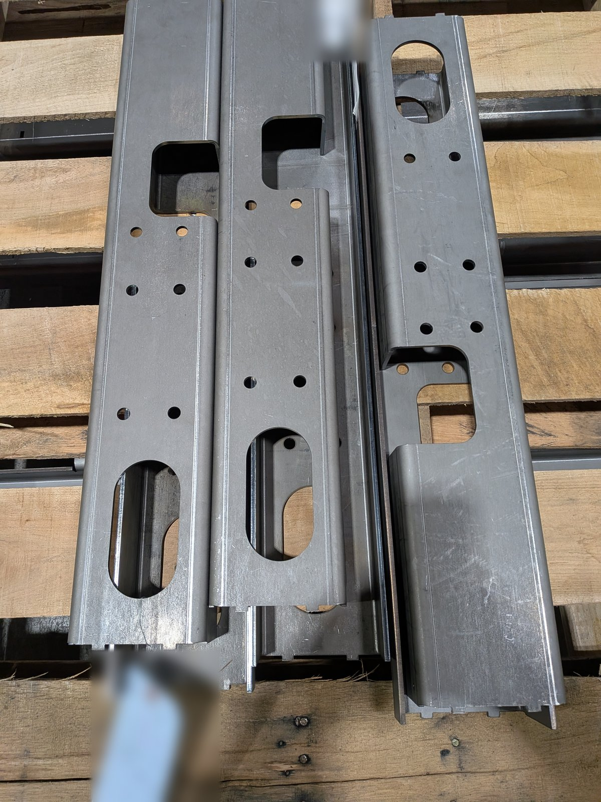
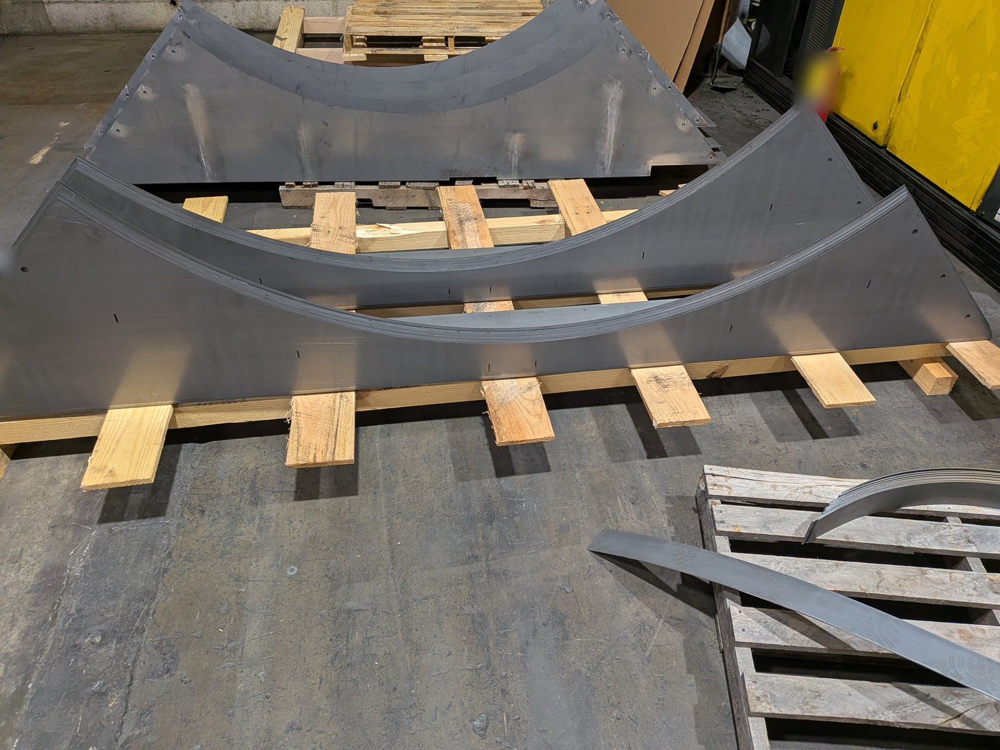
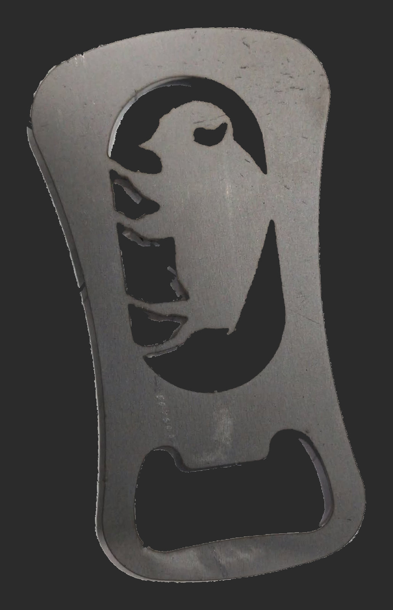

  

<h1 align="center">🛠️ Project Showcase</h1>

<strong>Photos of parts I have programmed and cut.</strong>

  
  
  

<em>Material and thickness are listed when I know them.</em>

  

## 🔩 Formed channels

**Material:** 14 ga HRPO (hot rolled pickled and oiled steel)

Formed channels with laser-cut holes, slots, and notches.

  

## 🔩 Formed channels with slots and cutouts

**Material:** 14 ga HRPO (hot rolled pickled and oiled steel)

Formed channels with laser-cut slots and cutouts.

  

## 🔩 Large curved panels

**Material:** 14 ga HRPO (hot rolled pickled and oiled steel)

Large curved panels.

  

## 🔩 Laser-cut bottle opener

**Material:** 11 ga stainless steel

Laser-cut bottle opener with an animal cutout.

  

⬅️ <a href="../README.md">Back to my portfolio</a>

<a href="#top">↑ Back to top</a>

  

