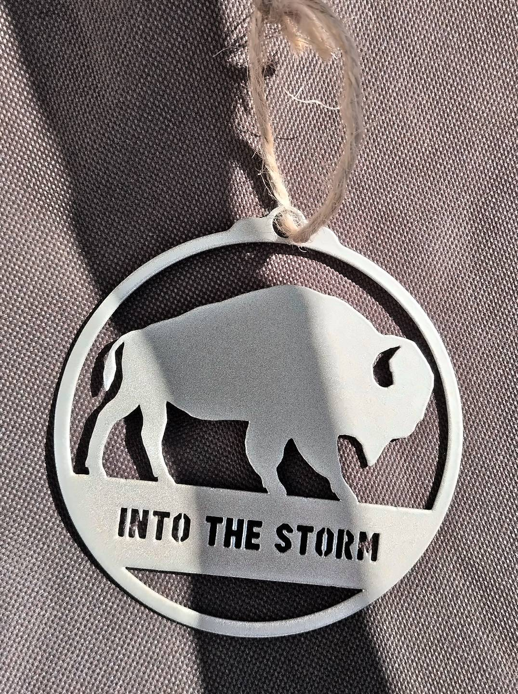

  

<h1 align="center">🎄 Christmas Ornament with Company Logo</h1>

  

<figure class="photo-tile" style="max-width: 520px; margin: 0 auto 1.5rem;">
  
  <figcaption class="photo-caption"><em>Christmas Ornament with Company Logo</em></figcaption>
</figure>

Cut from 3/16" stainless steel on the laser, then run through the Costa for a textured finish.

<strong>The hard part:</strong> The small letters in "INTO THE STORM." With tiny cutouts in thick stainless, heat builds up fast and the letters can come out uneven or melted. To stop that, I ran a few engraving passes on the letters first to keep the heat down, then made the final cut through. Every letter came out clean and the same.

<strong>The result:</strong> Sharp, even letters and a clean bison outline, with a finish that's ready to hang.

  

⬅️ <a href="../">Back to Project Showcase</a> &nbsp;·&nbsp; <a href="../../">Back to my portfolio</a>

<a href="#top">↑ Back to top</a>

  

